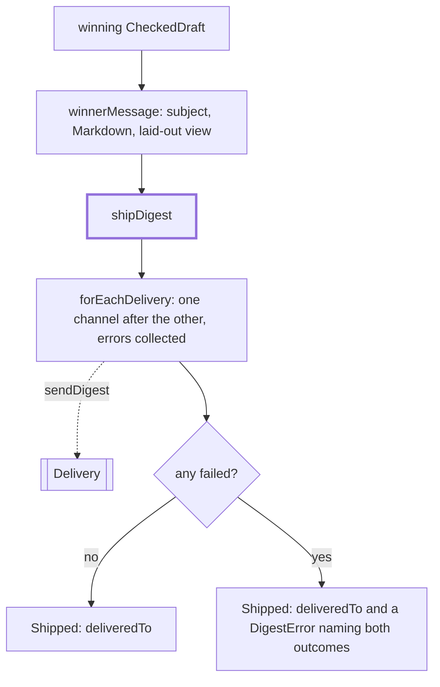

# Shipping

> Sends the winning digest to every channel and builds the message they get. Entries:
> `shipDigest(channels, message, alreadyDelivered) → Shipped`, `winnerMessage(ctx, winner, fallback)`
> and `digestMessage(weekId, headline, markdown, view?)`. Port: `Delivery.sendDigest`.

## Flow

## Rules

- `shipDigest` never throws and tries every channel; one that fails does not stop the others.
  `deliveredTo` lists the channels that already had the digest, then the ones that took it now.
- The error names what failed and what got through, so a rerun sends only to the others:
  `Delivery failed on email (SMTP 554); delivered on markdown`.
- The subject is one line, cut to 120 characters. A blank headline leaves it out. The view is added
  only when there is one, so a channel without a view shows the Markdown.
- `winnerMessage` marks a template-only fallback in the view footer and names the guards that were off.

## Files

| File               | Role                                                          |
| ------------------ | ------------------------------------------------------------- |
| `shipping.ts`      | `shipDigest`, `forEachDelivery`, `Shipped`, `DeliveryFailure` |
| `digestMessage.ts` | `digestMessage`, `winnerMessage`, `WinnerContext`             |

Tests sit next to each file; `digestMessage.winner.test.ts` covers `winnerMessage`.

## Gotchas

- `forEachDelivery` is also how `notes/` sends failure notes: keep it free of digest logic.
- `resume/` builds its message with `digestMessage` from the saved Markdown, so the subject must
  stay a function of week and headline only.
