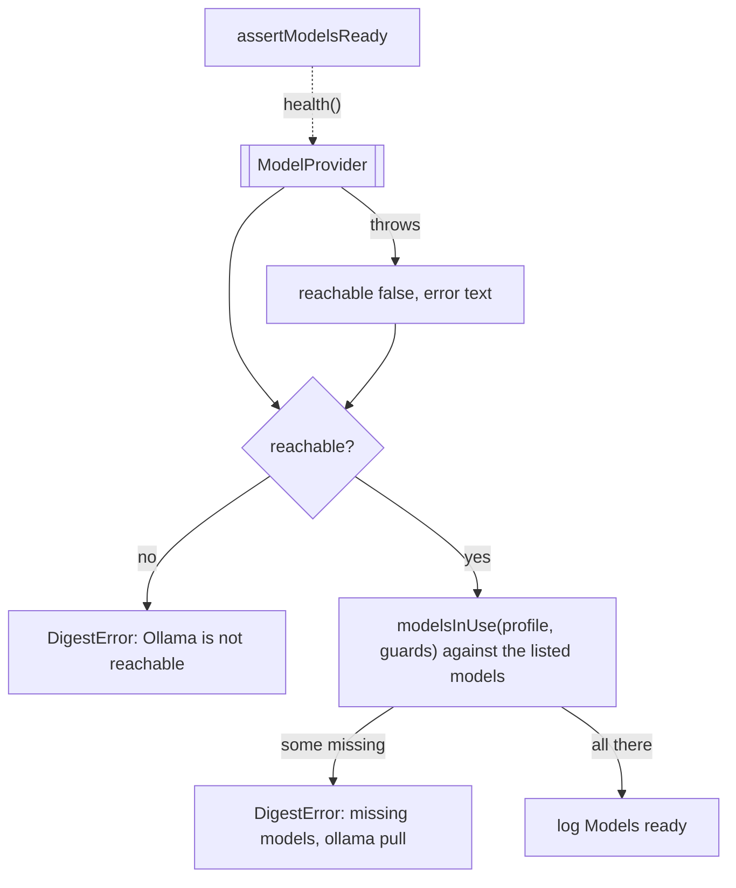

# Health

> Checks that Ollama is up and has every model this run uses, before anything is collected.
> Entry: `assertModelsReady(ctx)` (`assertModelsReady.ts`). Port: `ModelProvider.health()`.

## Flow

## Rules

- A guard role whose checks are all off needs no model (`modelsInUse`), so a switched-off guard does
  not demand a pull. The classifier, the writers and the judge are always needed.
- A tag without a version means `:latest` on both sides: Ollama lists `clef:latest` for `clef`.
- A health call that throws is a down Ollama with the error text, not a crash.
- It runs once, before the first stage. A resume does not call it: it makes no model call.

## Files

| File                   | Role                                                                      |
| ---------------------- | ------------------------------------------------------------------------- |
| `assertModelsReady.ts` | `assertModelsReady`, `HealthContext`; the private `readHealth`, `withTag` |

The test builds the context with `contextFor` (`__fixtures__/stageKit.ts`) and a `FakeModelProvider`
that lists models.

## Gotchas

- The error texts reach the run record and the failure note; tests pin them
  (`assertModelsReady.test.ts`, `runDigest.failures.test.ts`).
- The check passes `HealthContext`, a slice of the run context, so it needs no run to test.
