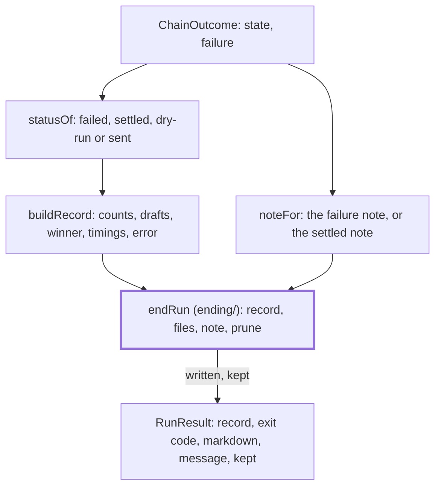

# Record

> Turns how a run ended into a `RunRecord` and a `RunResult`. Entries: `finish` for a run that went
> through the chain, `skipped` for a week already sent, `resumed` for a part-delivered week, all
> `(ctx, …) → RunResult`. Port: `RunStore`, through `endRun`.

## Flow

- `skipped` builds a record from `EMPTY_STATE` and saves nothing. `resumed` hands the week to
  `resume/` and returns the saved digest as `markdown`, with no `message`, and `kept` when set.
- `lastDelivered` reads the runs before the chain (only without `--since`): the latest earlier
  week that reached a channel, for `collect`. A store that cannot list them gives none, logged.

## Rules

- A record names writers, check ids, counts and urls; no model or feed text reaches it. The failure
  goes through `recordError`: message and step, never the stack.
- `markdown` is returned only for a file this run wrote: with `holdArtifacts` on, only when
  `digest.md` was among the held files `endRun` wrote. `message` does not depend on that.
- `afterProcess` is left out until the process stage ran; `fallback`, `deliveredTo` and `error`
  appear only when set. The lists are copies of the state's.

## Files

| File               | Role                                                                       |
| ------------------ | -------------------------------------------------------------------------- |
| `buildRecord.ts`   | `buildRecord`, `statusOf`: the `RunRecord` and its status                  |
| `finish.ts`        | `finish`, `noteFor`: end a chain run through `endRun` and shape the result |
| `skipped.ts`       | `skipped`: the result for a week that already has a sent digest            |
| `resumed.ts`       | `resumed`: the result of finishing a part-delivered week                   |
| `lastDelivered.ts` | `lastDelivered`: `RunContext.lastDelivered`, the late run's collect start  |

## Gotchas

- `RunRecordSchema` (`store/runRecord.ts`) validates every record in tests; a new field needs a
  default there first. `cli run`, the scheduler and the evals read `exitCode` and `kept`.
