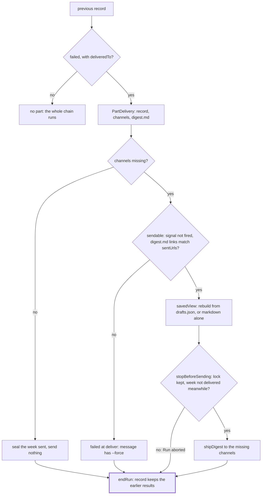

# Resume

> Finishes a week whose run failed after some channels took the digest: sends the saved digest.md
> to the channels that missed it. Entries: `loadPartDelivery(ctx, previous)` and
> `resumeDelivery(ctx, part)` (`resumeDelivery.ts`). Ports: `RunStore`, `Delivery`.

## Flow

## Rules

- No health check and no model call; dry runs and `--force` never resume. The abort signal (a lost
  lock too) is checked before the delivery starts and, with the week's record, last before the send.
- digest.md is sent only when its links are exactly `previous.sentUrls`: anything else would split
  the week across channels, so a person decides, with `--force`.
- The view is rebuilt from the winning draft in drafts.json only if it renders to the very digest.md
  the other channels got. Any mismatch or error sends the Markdown alone and logs why.
- The deliver step is traced and timed like a chain step; a broken tracer fails the delivery.
- After each channel it reaches it saves the record so far (`resumeProgress`, `DELIVERY_CUT_OFF`),
  so a resume killed midway goes on from there. `endRun` clears the failure notes once it is sent.

## Files

| File                | Role                                                                                  |
| ------------------- | ------------------------------------------------------------------------------------- |
| `resumeDelivery.ts` | `loadPartDelivery`, `resumeDelivery`, `ResumeContext`, `PartDelivery`, `ResumeResult` |
| `resumedRecord.ts`  | `resumedRecord`, `resumeProgress`: the record of a resume, at the end and per channel |

## Gotchas

- The refusal text `run with --force to send a new digest to every channel` is read by `needsForce`
  (`ending/notes/unretriable.ts`) and the scheduler: a change moves which failures retry.
