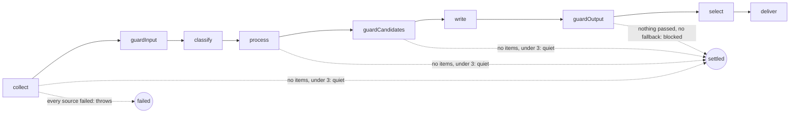

# Stages

> One function per step of the chain, each `(ctx, state, logger) => Promise<ChainState>`: it calls
> its feature's step with config and ports, saves the stage's file and says whether the run goes on.
> Entry: `chainSteps(ctx)`, the stages in order; a dry run has no `deliver`.

## Flow

| Stage             | Function          | Calls                                          | Leaves in `ChainState`                         |
| ----------------- | ----------------- | ---------------------------------------------- | ---------------------------------------------- |
| `collect`         | `collect`         | `collectStep`                                  | `collected`, `failedSources`; items.json       |
| `guardInput`      | `guardInput`      | `guardInputStep`, rule only                    | `kept`                                         |
| `classify`        | `classify`        | `classifyStep`                                 | `scored`; scores.json                          |
| `process`         | `processItems`    | `processStep`                                  | `selected`, `afterProcess`                     |
| `guardCandidates` | `guardCandidates` | `guardCandidatesStep`, `processStep` per round | `selected`, `guardedCandidates`                |
| `write`           | `write`           | `writeCheckedStep`                             | `checked`, `drafts`, `draftsFile`; drafts.json |
| `guardOutput`     | `guardOutput`     | `guardOutputStep`, fallback                    | `drafts`, `passed`, maybe `fallback`           |
| `select`          | `selectWinner`    | `selectStep` (2+ drafts)                       | `winner`, scored `drafts`; digest.md           |
| `deliver`         | `deliver`         | `shipDigest` (`ending/`)                       | `deliveredTo`, `sentUrls`                      |

## Rules

- `collect` throws `PartialFailure` when every configured source failed (network or DNS down), with
  the counts only: the run ends `failed`, so the scheduler retries it. Sources that answered with
  nothing, or some failed and none had items, still settle `quiet`.
- The model input guards check the picks, not every item (PERF-2): `guardInput` runs the rule guard
  alone and `guardCandidates` asks `processStep` again without each flagged pick. With
  `models.rescoreWithWriter` on, `modelGuardsFirst` keeps them in `guardInput` and `guardCandidates`
  returns the state as it is: a writer model must never read an item they did not check.
- `write` throws `PartialFailure` when every writer failed, naming writers, never model text; `guardOutput`
  falls back to `withFallback` when no draft passed.
- `collect` reads from `sinceDays` back, or from `RunContext.lastDelivered.startedAt` when that is
  earlier (a late run), never more than 31 days.
- With `RunContext.reuse`, `collect` fetches only `fetchSourceIds` (none: `collectStep` is not
  called), merges with `mergeByUrl` and logs `{ reused, fetched, merged }`; the quiet and
  all-sources-failed rules apply to the merged set and the fetched sources. `processorFor` passes
  `variant.keepUrls` as `boostUrls`; `process` stores `eligible`; `classify` and `write` pass
  `perspectiveOf(ctx)`. `guardCandidates` needs nothing: it picks through `processorFor`.
- `deliver` checks last before it sends (`stopBeforeSending`): it fails `Run aborted` when the signal
  fired (a lost lock too), or when another run reached a channel since `RunContext.previousRecord`.
  After each channel that takes the digest it saves a `failed` record with `DELIVERY_CUT_OFF`
  (`saveProgress`), so a run killed then is resumed, not sent again everywhere.
  `keepArtifact` writes nothing once `RunContext.lockLost` fired: the folder is the other run's.

## Files

| File                  | Role                                                                                                  |
| --------------------- | ----------------------------------------------------------------------------------------------------- |
| `chainSteps.ts`       | `chainSteps`: wraps each stage with `stage` from `chain/`; `collect.ts` … `deliver.ts` are the stages |
| `keepArtifact.ts`     | `keepArtifact`: write a run file now, or hold it (`holdArtifacts`)                                    |
| `modelGuardsFirst.ts` | `modelGuardsFirst`: whether the model input guards run before classify (`rescoreWithWriter`)          |
| `processWith.ts`      | `processorFor`: `processStep` with the run's config and sent URLs, for both picks                     |
| `draftOutcomes.ts`    | `rejected`, `inWriterOrder`, `blocked`: the draft outcomes of the record                              |
| `withFallback.ts`     | `withFallback`: the template-only digest as the one passing draft                                     |

## Gotchas

- The step name given to `stage()` in `chainSteps.ts` is the one the record and logs carry.
- A stage imports only `keepArtifact`, `draftOutcomes`, `withFallback`, `modelGuardsFirst` and
  `processWith`, never another stage. `deliver` tries every channel; one that took the digest counts
  its URLs as sent even when another failed.
