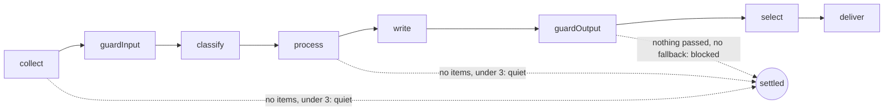

# Stages

> One function per step of the chain, each `(ctx, state, logger) => Promise<ChainState>`: it calls
> its feature's step with config and ports, saves the stage's file and says whether the run goes on.
> Entry: `chainSteps(ctx)`, the stages in order; a dry run has no `deliver`.

## Flow

| Stage         | Function       | Calls                       | Leaves in `ChainState`                         |
| ------------- | -------------- | --------------------------- | ---------------------------------------------- |
| `collect`     | `collect`      | `collectStep`               | `collected`, `failedSources`; items.json       |
| `guardInput`  | `guardInput`   | `guardInputStep`            | `kept`                                         |
| `classify`    | `classify`     | `classifyStep`              | `scored`; scores.json                          |
| `process`     | `processItems` | `processStep`               | `selected`, `afterProcess`                     |
| `write`       | `write`        | `writeCheckedStep`          | `checked`, `drafts`, `draftsFile`; drafts.json |
| `guardOutput` | `guardOutput`  | `guardOutputStep`, fallback | `drafts`, `passed`, maybe `fallback`           |
| `select`      | `selectWinner` | `selectStep` (2+ drafts)    | `winner`, scored `drafts`; digest.md           |
| `deliver`     | `deliver`      | `shipDigest` (`ending/`)    | `deliveredTo`, `sentUrls`                      |

## Rules

- `write` throws `PartialFailure` when every writer failed, naming writers, never model text; `guardOutput`
  falls back to `withFallback` when no draft passed.

## Files

| File               | Role                                                                                                  |
| ------------------ | ----------------------------------------------------------------------------------------------------- |
| `chainSteps.ts`    | `chainSteps`: wraps each stage with `stage` from `chain/`; `collect.ts` … `deliver.ts` are the stages |
| `keepArtifact.ts`  | `keepArtifact`: write a run file now, or hold it (`holdArtifacts`)                                    |
| `draftOutcomes.ts` | `rejected`, `inWriterOrder`, `blocked`: the draft outcomes of the record                              |
| `withFallback.ts`  | `withFallback`: the template-only digest as the one passing draft                                     |

## Gotchas

- The step name given to `stage()` in `chainSteps.ts` is the one the record and logs carry.
- A stage imports only `keepArtifact`, `draftOutcomes` and `withFallback`, never another stage. `deliver`
  tries every channel; one that took the digest counts its URLs as sent even when another failed.
