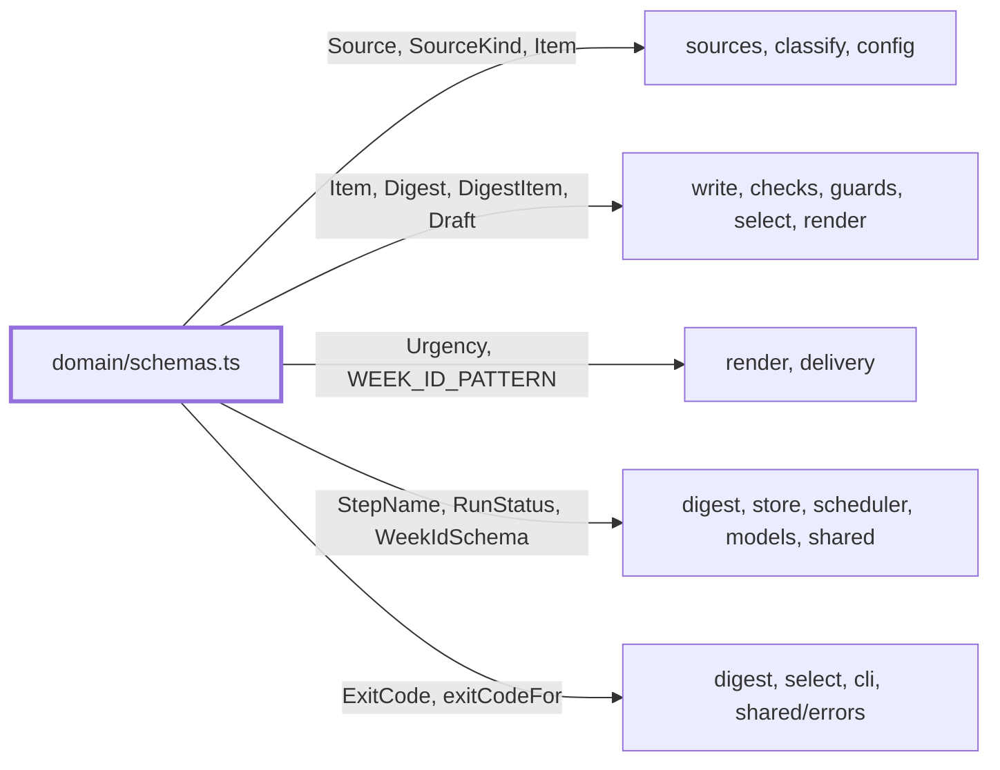
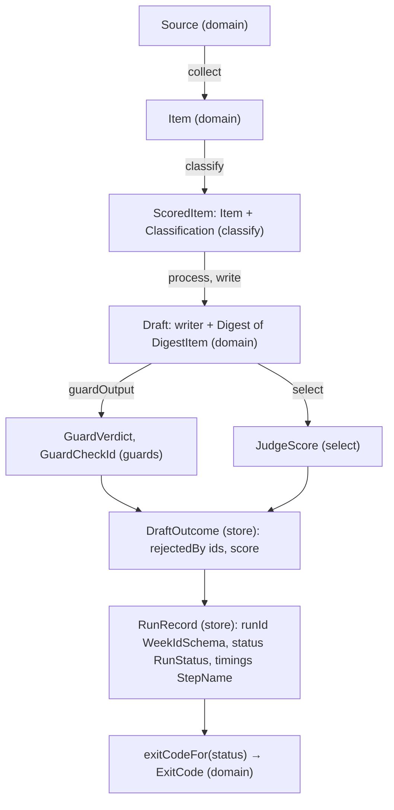

# Domain

> The types several features share: sources, items, digests, drafts, week ids, step names, run status
> and exit codes. One file, `schemas.ts`: zod schemas with their `z.infer` types. A type with one
> owner lives in that feature instead. It imports `zod` and nothing else.

## Context

## Flow

- Also owned elsewhere: `Role` (`models/roles.ts`), `DeliveryId` (`delivery/deliveryId.ts`).
  `store/runRecord.ts` imports the schemas of `GuardCheckId`, `JudgeScore` and `DeliveryId` from those
  small zod-only files. `rejectedBy` holds guard ids and also `linkCheck` and `formatCheck`, plain strings.
- `Item.id` is the first 16 hex chars of sha256 of the normalized URL (`itemIdFor`, `shared/url.ts`).
  Week ids look like `2026-W43`, weeks 01 to 53 (`WEEK_ID_PATTERN`); `RunRecord.runId` is the week id.
- `Source.id` is lowercase letters, digits and dashes; `area` is a classifier hint; `maxItems` (1-100)
  caps one source and falls back to `config.maxItemsPerSource`.

## Rules

- No imports from other `src/` folders: this is the bottom of the dependency graph.
- Types come from the schemas with `z.infer`, never written by hand next to a schema.
- A new field on a stored shape is optional: saved `run.json`, recorded eval weeks and old drafts must
  still parse. `DigestItem.urgency` and `action` are absent in older drafts; `urgency` then reads as
  `worth-a-look` (`render/layout.ts`).
- `Item` text fields are untrusted web content; parsing does not make them safe.
- `DigestSchema` asks for at least one item. The 3-5 rule is `checks/formatCheck.ts`, so recorded
  digests still parse. `DigestItem.action` is capped at 200 characters; word limits are the format check's.
- `exitCodeFor` is a switch with no default, so a new `RunStatus` fails the typecheck until it is
  mapped: `sent`, `dry-run`, `skipped` give 0, `failed` 1, `blocked` 2, `quiet` 3.

## Files

| File         | Role                                                                                  |
| ------------ | ------------------------------------------------------------------------------------- |
| `schemas.ts` | The shared schemas and types, `WEEK_ID_PATTERN`, `Urgency`, `ExitCode`, `exitCodeFor` |

`schemas.test.ts` covers the exit code mapping, that the builders parse and a bad week id. No fixtures.

## Gotchas

- Frozen contract file (`.claude/rules/parallel-work.md`): change it on `main`, then rebase open branches.
- A change reaches far files. `pnpm check` (the typecheck) matters more than `schemas.test.ts`.
- `test/builders.ts` builds valid objects from these schemas: update it in the same change. The parse
  cases for old records are in `store/runRecord.test.ts`.
- Do not rename an enum value (`RunStatus`, `StepName`, `Urgency`, `SourceKind`): stored files and
  prompts hold the old string.
- `Source` is also every entry of `sources` in `digest.config.json` (`config/schema.ts` refines it): a
  change to it is a change to the user's config.
