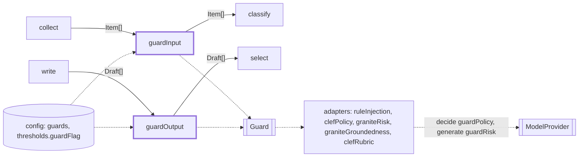
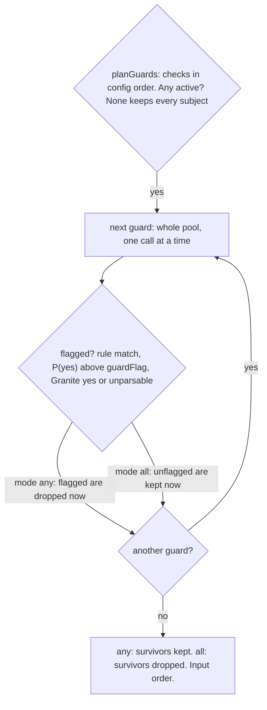

# Guards

> Safety checks on untrusted text: input guards judge each collected item, output guards each draft.
> Entries: `guardInputStep(items, deps)`, `guardOutputStep(drafts, sources, deps)`. Port: `Guard`
> (`InputGuard`, `OutputGuard`). The link and format checks are not guards: they live in `src/checks`.

## Context

## Flow

- `ruleInjection` (input, no model call): flags when a rule in `RULES` matches the title, summary
  or URL; the reason is `ruleInjection: id1, id2`. A hit drops the item in mode `all` too:
  `guardInputStep` runs it first as `ALWAYS_BLOCKING`.
- `clefPolicy` (input) and `clefRubric` (output): one `decide` call, role `guardPolicy`, several
  yes/no questions. Flag when any P(yes) is above `thresholds.guardFlag` (0.35, strict, both).
- `graniteRisk` asks `jailbreak`, then `harm`, stopping at the first yes. `graniteGroundedness`
  checks each digest item against its source item, then headline and intro against all cited
  sources. Both are `generate` calls at temperature 0.

## Rules

- Fail closed. Granite's reply must be only `<score>yes|no</score>` after the last `</think>`
  (`parseGraniteScore`), else it flags as `unparsable guard output`. A missing or malformed `decide`
  answer throws `DigestError`; a digest item with no source item flags. A guard error fails the run.
- `GUARD_CONCURRENCY` is 1 on purpose: on 2026-10-17 limits 1, 2 and 4 all took about 112 s with the
  same verdicts. Raise it only after timing a server that runs requests in parallel.
- A disabled or missing guard is never silent: it is in `disabledChecks`, `run.json`
  (`disabledGuards`) and the digest footer; a missing one also logs a warning.
- Granite criteria, except `headline` and `item`, are copied from its chat template: do not reword
  them. Those two are our own wording (`GRANITE_CRITERIA.item` for each digest item): the generic
  headline one flagged editorial framing, the generic item one flagged a plain why-it-matters line.
- Logs and reasons hold ids and check ids only, never item, draft or model text.

## Files

| File                                             | Role                                                                                                            |
| ------------------------------------------------ | --------------------------------------------------------------------------------------------------------------- |
| `Guard.ts`, `guardVerdict.ts`                    | The port; `GuardCheckIdSchema`, `GuardVerdictSchema`: the types we own                                          |
| `guardRun.ts`, `guardInput.ts`, `guardOutput.ts` | `planGuards`, `applyGuards`, `flaggedBy`; `guardInputStep`, `guardOutputStep`                                   |
| `guardQuestions.ts`                              | Questions and states: the item URL is shown, the writer's name is not; short for `strands-decider`'s 4K context |
| `adapters/`                                      | The five guards (rule, Clef, Granite), `GRANITE_CRITERIA`, recorded fixtures: see `adapters/CLAUDE.md`          |

Tests sit next to the code; `adapters/__fixtures__/granite/` holds 9 recordings of live Granite calls.

## Gotchas

- A guard runs only if its id is a key of `guards.input|output.checks`: `planGuards` walks those
  keys in order, not the guards built. `ruleInjection` is first, so it runs before the model
  guards. A new guard needs a key in frozen `config/schema.ts`.
- `ruleInjection.test.ts` pins `evals/weeks` (6 weeks, 369 items) and `evals/sources` as clean and
  needs 8 of the first 10 `evals/attacks` flagged: recording a new week changes the count.
- `graniteRecorded.test.ts` replays fixtures that store the prompts: a prompt change fails it until
  they are recorded again (live Ollama, one at a time). `guardQuestions.test.ts` pins the wording,
  e.g. that reporting a security fix is not harmful. Any question change moves verdicts: re-check
  the thresholds in `evals/`.
- Callers: `digest/stages/guardInput.ts` and `guardOutput.ts`, `digest/fallback.ts` (runs
  `guardOutputStep` on the template digest, advisory only) and `evals/classifierRun/checkGrounding.ts`.
  Check ids are stored in `run.json`: renaming breaks them. The steps pass no abort signal.
