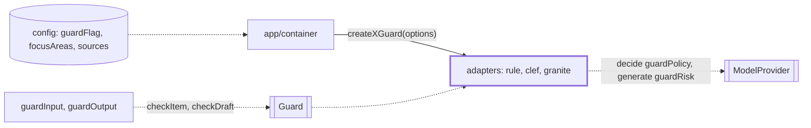
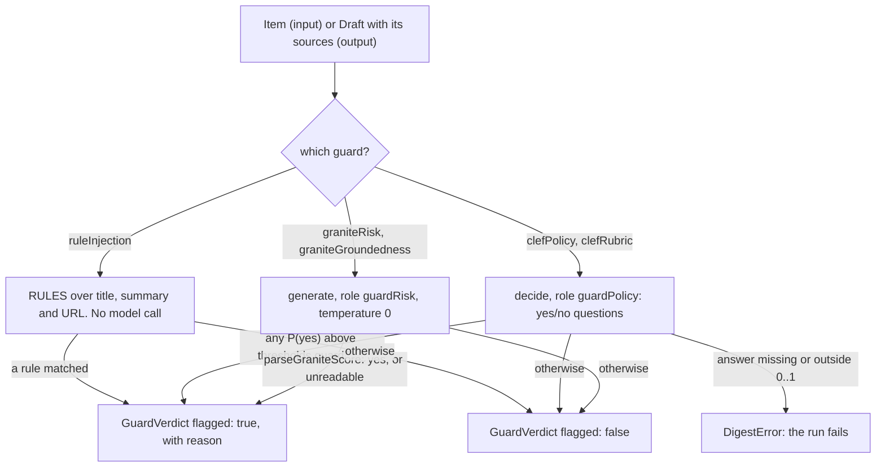

# Guard adapters

> The five guards behind the `Guard` port. Input (`InputGuard.checkItem`): `createRuleInjectionGuard`,
> `createClefPolicyGuard`, `createGraniteRiskGuard`. Output (`OutputGuard.checkDraft`):
> `createGraniteGroundednessGuard`, `createClefRubricGuard`. Each answers with one `GuardVerdict`.

## Context

## Flow

- A verdict is `{ check, flagged, probability?, reason? }`. Clef always sets `probability` (the
  highest P(yes)) and a reason per question over the threshold. The others give only a reason: rule
  ids, `granite4.1-guardian flagged jailbreak`, item ids (cut to 40 characters) or `unparsable guard output`.
- `graniteRisk` asks `jailbreak`, then `harm`, and stops at the first yes or unreadable reply.
  `graniteGroundedness` makes one `item` call per digest item (its claim text against its own source
  item), then one `headline` call against every source cited. An item with no source flags the draft.
- A guard is on only if `planGuards` finds its check on; `buildApp` builds all five anyway. An off
  check goes to `disabledChecks` (`run.json`, the footer). A role whose checks are all off needs no
  model (`modelsInUse`), so doctor skips its tag.

## Rules

- Clef asks `decide` on `guardPolicy`, Granite `generate` on `guardRisk`, the rule guard no model.
  `unusedGuardRoles` (`config/profiles.ts`) relies on this map to pick the tags doctor needs.
- Only Clef reads a threshold: `thresholds.guardFlag` (0.35) as `flagThreshold`, flag when P(yes) is
  above it, for both guards. A value outside 0..1 throws at creation. Granite gives no probability.
- A Granite call is the criterion plus `UNTRUSTED_DATA_RULE` as the system prompt and the wrapped
  data as the user message: the rule in the judged message made groundedness worse. Text comes
  from `canonicalClaimText` and `canonicalHeadlineText`: the bytes stay those of the recordings.
- The rule guard has no state. A rule is one entry in `RULES` plus a bad and a good case in
  `ruleInjection.test.ts`. It blocks in mode `all` too, as a hit is certain: `guardInputStep` runs
  it first as `blocking`. Known hosts: `allowedHosts` (the feed hosts) and the item's own host.
- `hiddenChars` has two lists in `ruleInjectionRules.ts`. Bidi embeddings, overrides and isolates,
  the deprecated controls U+206A-206F and the tag block flag anywhere. Zero-width characters, the
  soft hyphen, the BOM, the LRM and RLM (U+200E, U+200F) and the Arabic letter mark U+061C flag only
  between two Latin letters: next to Hebrew or Arabic letters, a digit, a space or punctuation they
  are real bidi text, and a BOM starts a file. `INVISIBLE` in `ruleInjection.ts` is a wider,
  separate list that the phrase rules read through: keep the three in step.

## Files

| File                    | Role                                                                               |
| ----------------------- | ---------------------------------------------------------------------------------- |
| `ruleInjection.ts`      | `createRuleInjectionGuard`, `RuleInjectionOptions`: the context, `RULES`, verdict  |
| `ruleInjectionRules.ts` | `RULES` (each with the attack it catches), `RuleContext`, `RULE_IDS`, link helpers |
| `clefPolicy.ts`         | `createClefPolicyGuard` and `createClefRubricGuard` over one `decide` call         |
| `granite.ts`            | The two Granite guards, `GRANITE_CRITERIA`, `parseGraniteScore`                    |
| `__fixtures__/granite/` | 9 recordings from `granite4.1-guardian:8b`: the prompts sent, the replies, verdict |

`graniteRecorded.test.ts` replays the fixtures. `clefRubricContext.test.ts` runs the rubric guard
through the real Ollama adapter (fake `fetch`): a full-size draft must fit `strands-decider` whole.

## Gotchas

- The run's abort signal reaches a guard: the steps pass it as `GuardCallOptions.signal`, and Clef and
  Granite forward it to the model. An aborted call must throw. A guard that caught it and answered
  would turn an abort into a flag or a pass; the rule guard makes no call, the steps stop it.
- `graniteRecorded.test.ts` compares the stored `system` and `prompt` with what the guard sends: a
  new criterion, data rule, `itemGuardText` or claim text fails it until the fixtures are recorded
  again by hand on live Ollama (`recordedWith` says how). The headline call is not recorded (the
  replay answers `no`); `granite.headline.test.ts` pins it.
- `evals/thresholds` builds the Clef and Granite risk guards; `test/live/think.live.test.ts` imports
  `GRANITE_CRITERIA` and `parseGraniteScore`. A new guard also needs `GuardCheckIdSchema`,
  `cli/doctor/checks/guards.ts` and, with a model, `unusedGuardRoles`.
