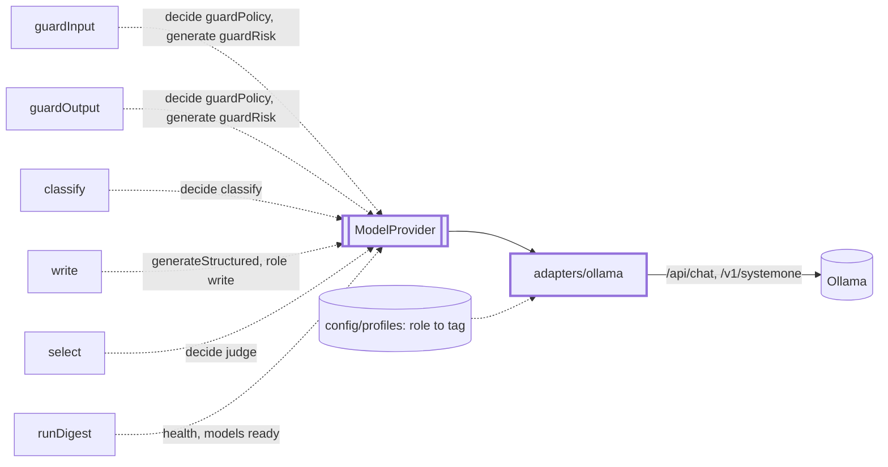
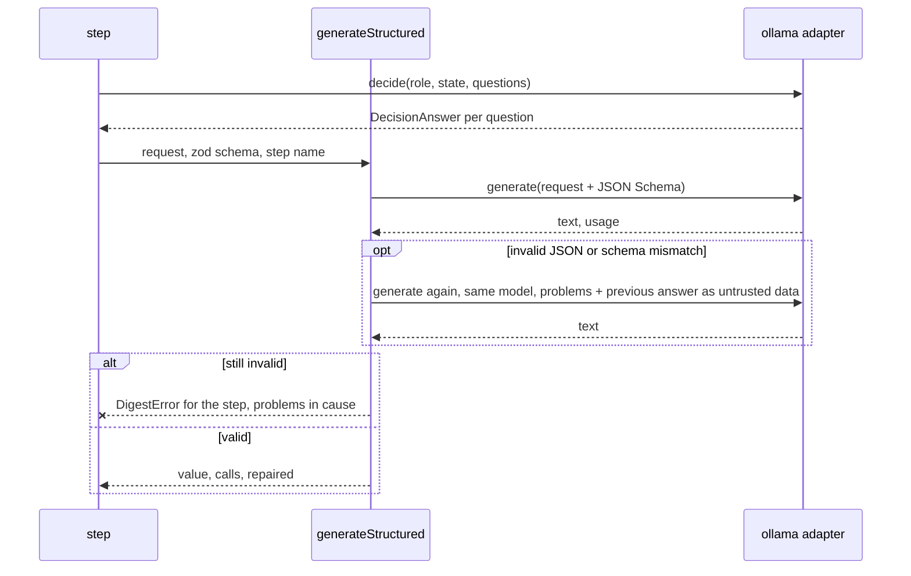

# Models

> Every model call goes through one port, `ModelProvider`: `generate` (text or JSON), `decide`
> (typed questions, probabilities back) and `health`. A step asks for a `Role`, never a tag.
> `generateStructured(model, request, schema, step)` (`structured.ts`) is the entry for JSON.

## Context

## Flow

## Rules

- The tag comes from the profile by role (`write`: first writer, unless the request names a
  `model`). A role with no tag, `judge` on a profile without one, throws `DigestError`: no default.
- Every call runs in `callOllama`. Timeout per attempt: classify 60 s, guardPolicy 60 s, guardRisk
  120 s, judge 120 s, write 600 s (`models.timeoutsMs` overrides). Retries: 2 (config 0-5), backoff
  1 s doubling to 10 s, on timeout, network or stream error, HTTP 5xx; not on 4xx or a bad payload.
  A caller abort passes through as it is, and an already-aborted signal ends the call before a request
  goes out; `generateStructured` does the same before its repair call. A timeout is retried, except
  for `write`: its seed is fixed, so a retry would repeat the same work.
- Temperature: request, else config, else default (`write` 0.2, others 0); the config seed (42) goes
  with each `generate` that has none. `think` is off by default for `guardRisk` only: Granite spends
  about 65 s thinking. `effectiveTemperature` and `effectiveThink` own these rules.
- A reply cut at the token limit is returned as is with a warning; `generateStructured` repairs it.
- `decide` takes 1-64 questions, 2-26 choice options, 2-10 unique score levels; a missing or
  mistyped answer throws. The state is cut to the model's context less the questions (`adapters/decide/`).
- `health()` never throws: no version means unreachable, failing tags mean no models.

## Files

| File / folder                           | Role                                                                                         |
| --------------------------------------- | -------------------------------------------------------------------------------------------- |
| `ModelProvider.ts`, `roles.ts`          | The port and its request, answer and health types; `Role`                                    |
| `structured.ts`                         | `generateStructured`: schema in, validated object out, one repair                            |
| `adapters/ollama.ts`                    | `createOllamaProvider`: wires the three calls. The folder: `adapters/CLAUDE.md`              |
| `adapters/call/`                        | `callOllama`: timeout, retries, log, errors; `resolveModel`. See `adapters/call/CLAUDE.md`   |
| `adapters/chat/`                        | `generate` on `/api/chat`: body, stream, `think`, temperature. See `adapters/chat/CLAUDE.md` |
| `adapters/decide/`                      | `decide` on `/v1/systemone`: the call, the state fit. See `adapters/decide/CLAUDE.md`        |
| `adapters/health/`                      | `health`: version and installed models. See `adapters/health/CLAUDE.md`                      |
| `adapters/ollamaHttp.ts`, `endpoint.ts` | The fetch transport and its errors; the `OLLAMA_URL` parse (credentials to a header)         |
| `adapters/systemone.ts`                 | The `/v1/systemone` mapping                                                                  |

Tests sit next to the code; `adapters/__fixtures__/` holds the replies and the test kit.

## Gotchas

- `cli/doctor` reads `effectiveThink`; `app/container` reads `effectiveTemperature` for the run
  record. Both live in `adapters/chat/chatSettings.ts`. `FakeModelProvider` and
  `test/integration/fakeOllama.ts` follow the port: change both.
