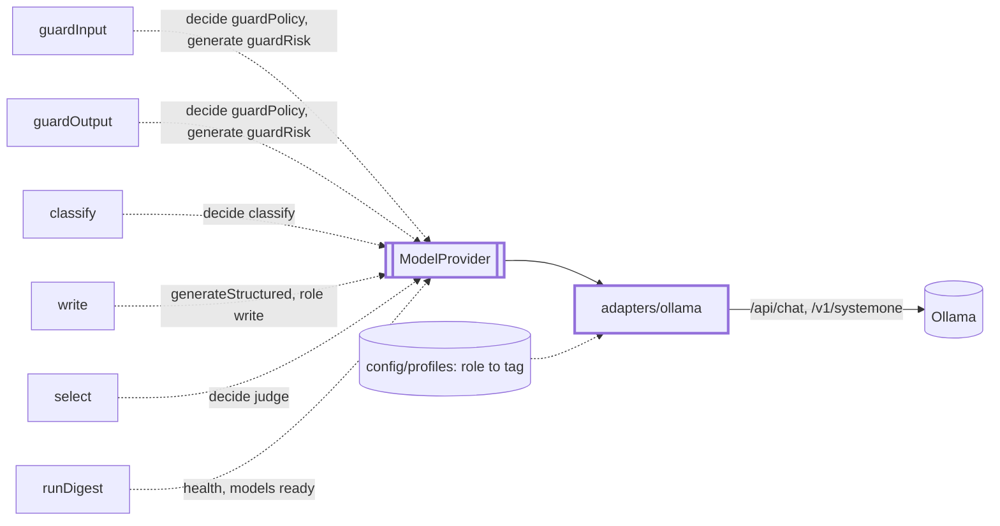
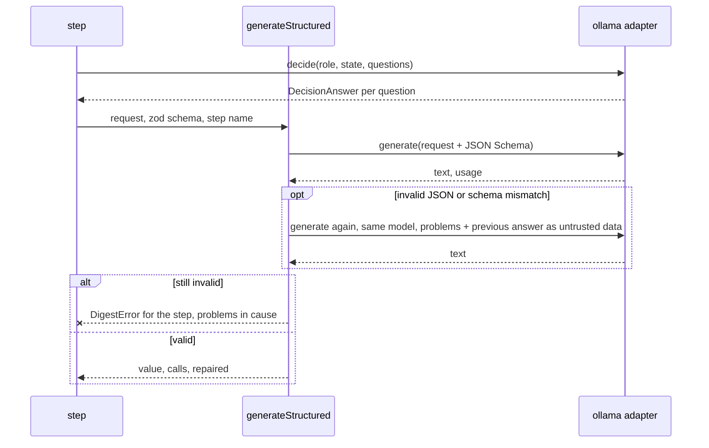

# Models

> Every model call goes through one port, `ModelProvider`: `generate` (text or JSON), `decide`
> (typed questions, probabilities back) and `health`. A step asks for a `Role`, never a tag.
> `generateStructured(model, request, schema, step)` (`structured.ts`) is the entry for JSON.

## Context

## Flow

## Rules

- The tag comes from the profile by role (`write`: first writer, unless the request names a
  `model`). A role with no tag, `judge` on a profile without one, throws `DigestError`: no default.
- Every call runs in `callOllama`. Timeout per attempt: classify 60 s, guardPolicy 60 s, guardRisk
  120 s, judge 120 s, write 600 s (`models.timeoutsMs` overrides). Retries: 2 (config 0-5), backoff
  1 s doubling to 10 s, on timeout, network or stream error, HTTP 5xx; not on 4xx or a bad payload.
  A caller abort passes through as it is. A timeout is retried, so a `write` call can run 3 x 600 s.
- Temperature: request, else config, else default (`write` 0.2, others 0); the config seed (42) goes
  with each `generate` that has none. `think` is off by default for `guardRisk` only: Granite spends
  about 65 s thinking. `effectiveTemperature` and `effectiveThink` own these rules.
- Chat is streamed (Node drops a response whose headers take over 300 s). A reply cut at the token
  limit is returned as is with a warning; `generateStructured` repairs it.
- `decide` takes 1-64 questions, 2-26 choice options, 2-10 unique score levels; a missing or
  mistyped answer throws. State is cut to 48,000 chars less the questions (10,000 for
  `strands-decider`, a 4K model), never under 1,000; head and 10% tail stay.
- Logs carry role, model, op, latency, attempts and tokens, never a prompt or an answer. `health()`
  never throws (5 s per request): no version means unreachable, failing tags mean no models.

## Files

| File                           | Role                                                                         |
| ------------------------------ | ---------------------------------------------------------------------------- |
| `ModelProvider.ts`, `roles.ts` | The port and its request, answer and health types; `Role`                    |
| `structured.ts`                | `generateStructured`: schema in, validated object out, one repair            |
| `adapters/ollama.ts`           | `createOllamaProvider`, `callOllama`, per-role defaults, `health`            |
| `adapters/ollamaHttp.ts`       | fetch transport (JSON, NDJSON), typed errors, `isRetryable`, `toDigestError` |
| `adapters/systemone.ts`        | Port questions and answers to and from `/v1/systemone`, limits, state trim   |

## Gotchas

- Ollama changes a reply: record it again into `adapters/__fixtures__/ollama/` (taken from Ollama
  0.40.4) and update the mapping and its test together. Live checks: `test/live/`, `LIVE_OLLAMA=1`.
- `cli/doctor` reads `effectiveThink`; `app/container` reads `effectiveTemperature` for the run
  record. `FakeModelProvider` and `test/integration/fakeOllama.ts` follow the port: change both.
- `ollama.ts` is 358 lines, over the 300 cap. Split it before adding to it.
