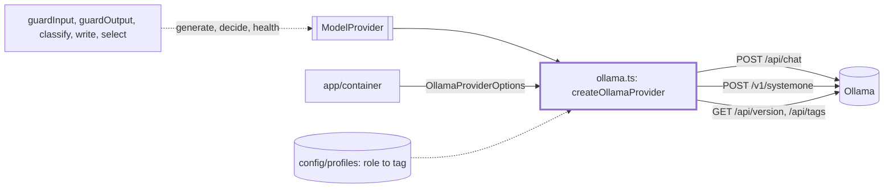
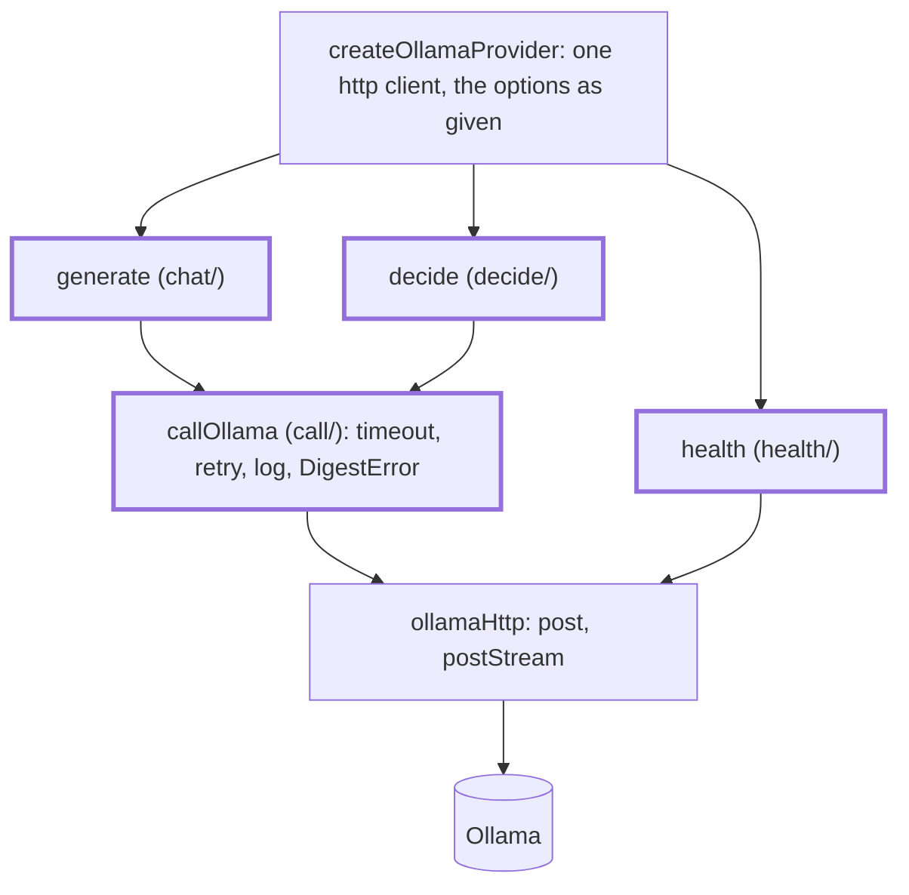

# Model adapters

> The Ollama `ModelProvider`: `createOllamaProvider(options) → ModelProvider` (`ollama.ts`). One
> server, two backends: `/api/chat` for text (`generate`) and `/v1/systemone` for typed questions
> (`decide`), plus `/api/version` and `/api/tags` for `health`. The entry file only wires the
> three calls; each one is a subfeature folder.

## Context

## Flow

- Roles pick the backend. A real run uses `decide` for `classify`, `guardPolicy` and `judge`
  (decision models such as `clef` and `strands-decider`) and `generate` for `write` and `guardRisk`
  (Granite). `classify` also has a `generate` mode, used in tests.

## Rules

- Timeouts and retries per role live here, not in the steps: `DEFAULT_TIMEOUTS_MS` and the retry
  loop are in `call/`. A step never sees a retry.
- The request bodies are pinned by recorded replies and wire tests: a changed field changes every
  call. Ollama 0.40.4 shapes sit in `__fixtures__/ollama/`.
- The provider passes its options object as it is; `chat/` and `decide/` read narrower slices
  (`ChatOptions`, `CallOptions`). A new option goes on the slice that reads it.
- `chat/` and `decide/` import `call/`; `call/` and `health/` import neither. No folder imports
  `ollama.ts`. Only `ollamaHttp.ts` calls `fetch`.
- Logs carry role, model, op, latency, attempts, tokens and `think`, never a prompt or an answer.
- A password in `OLLAMA_URL` never travels in a URL: `endpoint.ts` cuts `user:password@` out and
  `ollamaHttp.ts` sends it as a Basic `authorization` header. Node's `fetch` refuses such a URL and
  quotes it whole in its error, which would reach the log and `run.json`.
- Redirects are never followed (`redirect: 'manual'`): a 307 or 308 would re-send the prompts, which
  hold feed text, to another host. Any 3xx is a `DigestError` that says to set `OLLAMA_URL`; no retry.
- An `OLLAMA_URL` without `http://` or `https://` fails each request at once with a `DigestError`, no
  retry. Other network errors name the full request URL.

## Files

| File / folder   | Role                                                                                         |
| --------------- | -------------------------------------------------------------------------------------------- |
| `ollama.ts`     | `createOllamaProvider`, `OllamaProviderOptions`                                              |
| `ollamaHttp.ts` | fetch transport (JSON, NDJSON), typed errors, `isRetryable`, `toDigestError`                 |
| `endpoint.ts`   | `parseEndpoint` (root and Basic header from `OLLAMA_URL`), `hasHttpScheme`, secrets of a URL |
| `systemone.ts`  | Port questions and answers to and from `/v1/systemone`, limits, state trim                   |
| `call/`         | One model call: timeout, retries, log, errors; `resolveModel`. See `call/CLAUDE.md`          |
| `chat/`         | `generate`: the streamed chat call, `think` and sampling. See `chat/CLAUDE.md`               |
| `decide/`       | `decide`: the questions call and the state fit. See `decide/CLAUDE.md`                       |
| `health/`       | `health`: version and installed models, never throws. See `health/CLAUDE.md`                 |
| `__fixtures__/` | `ollama/`: replies recorded from Ollama; `ollamaHarness.ts`: fake fetch, logger and context  |

`ollama.test.ts` checks the wiring: options reach the right call, the port works as a whole.

## Gotchas

- `app/container` and `cli/doctor` import `effectiveTemperature`, `effectiveThink` and `ThinkSetting`
  from `chat/chatSettings.ts`: keep them there.
- `src/app/container*.test.ts` mock `../models/adapters/ollama` and wrap `createOllamaProvider`: keep
  that name and place.
- `app/redaction` and `cli/doctor/checks/host.ts` import `urlCredentialSecrets` and `hasHttpScheme`
  from `endpoint.ts`.
- Changing a mapping means re-recording the fixture in `__fixtures__/ollama/` and its test together.
  Live checks: `test/live/`, `LIVE_OLLAMA=1`.
