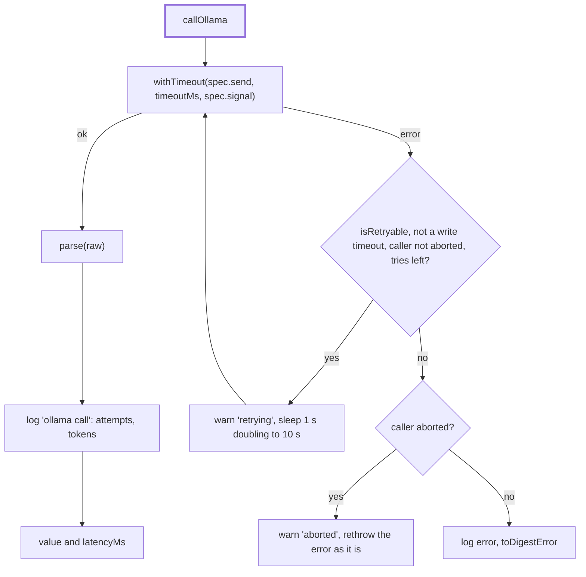

# Call

> One model call for the Ollama adapter: a timeout per attempt, retries with backoff, one log line
> and errors a user can read. Entry: `callOllama(context, spec, parse) → T & { latencyMs }`
> (`callOllama.ts`). `resolveModel(profile, role, explicit?)` picks the tag.

## Flow

## Rules

- The timeout is per attempt and per role: `options.timeoutsMs[role]`, else `DEFAULT_TIMEOUTS_MS`
  (classify and guardPolicy 60 s, guardRisk and judge 120 s, write 600 s). A timeout is retried,
  except for `write` (`repeatsSameWork`): its seed is fixed, so a retry repeats the same work.
- A cold call gets more time. `loads` (`loadTracker.ts`) remembers the model the server answered
  last; a call to any other model (the first call of the run, or after a model swap) adds
  `options.coldStartMs` (`DEFAULT_COLD_START_MS`, 5 min; 0 turns it off) to every attempt's
  timeout and logs `coldStart: true`. Measured 2026-10-19: the first `guardPolicy` call to clef
  timed out at 60 s while it loaded, then took 47 s more (107 s in all). A model is marked loaded
  only when a call to it answered, and the tracker holds one model: `OLLAMA_MAX_LOADED_MODELS=1`.
  Chosen over a load request before the first call: no new request type to get wrong (a decision
  model may not answer `/api/generate`), and no extra call in every test and run.
- Retries: `options.retries`, else 2, only for `isRetryable` errors (`ollamaHttp.ts`) and never once
  the caller has aborted: a cancelled run must stop at once. The back-off starts at
  `options.retryBaseDelayMs` (default 1 s): integration tests set 1 ms instead of waiting seconds.
- `parse` runs outside the retry loop: a payload that does not parse is not asked for again.
- A caller abort is rethrown as it is, not wrapped in a `DigestError`.
- One log line per call (role, model, op, latency, attempts, tokens, `coldStart` on a cold call, the
  spec's `logFields`), never the prompt or the answer.

## Files

| File              | Role                                                                   |
| ----------------- | ---------------------------------------------------------------------- |
| `callOllama.ts`   | `callOllama`, `DEFAULT_TIMEOUTS_MS`, the retry constants               |
| `loadTracker.ts`  | `createLoadTracker`: which model the server answered last (cold start) |
| `resolveModel.ts` | `resolveModel`: explicit tag, else the role's first tag in the profile |
| `types.ts`        | `OllamaContext` (http, options, loads), `CallOptions`, `CallSpec`      |

Tests run on the fake `fetch` of `../__fixtures__/ollamaHarness.ts`, with fake timers for retries.
`fakeContext` sets `coldStartMs: 0`, so the timeout tests mean what they say; the cold-start tests and
`test/integration/coldStart.test.ts` (the real provider on the fake Ollama) set it.

## Gotchas

- `CallContext` in `ollamaHttp.ts` is another type: the data `toDigestError` puts in its message.
