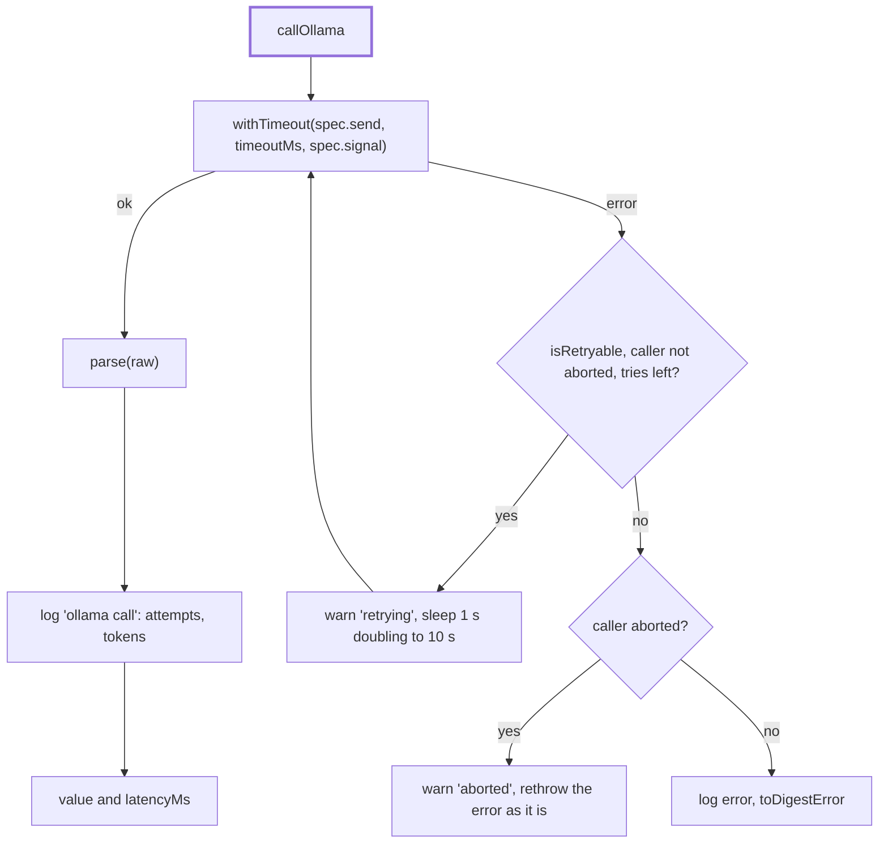

# Call

> One model call for the Ollama adapter: a timeout per attempt, retries with backoff, one log line
> and errors a user can read. Entry: `callOllama(context, spec, parse) → T & { latencyMs }`
> (`callOllama.ts`). `resolveModel(profile, role, explicit?)` picks the tag.

## Flow

## Rules

- The timeout is per attempt and per role: `options.timeoutsMs[role]`, else `DEFAULT_TIMEOUTS_MS`
  (classify and guardPolicy 60 s, guardRisk and judge 120 s, write 600 s). A timeout is retried, so
  a `write` call can take 3 x 600 s.
- Retries: `options.retries`, else 2, only for `isRetryable` errors (`ollamaHttp.ts`) and never once
  the caller has aborted: a cancelled run must stop at once.
- `parse` runs outside the retry loop: a payload that does not parse is not asked for again.
- A caller abort is rethrown as it is, not wrapped in a `DigestError`.
- One log line per call (role, model, op, latency, attempts, tokens, the spec's `logFields`), never
  the prompt or the answer.

## Files

| File              | Role                                                                   |
| ----------------- | ---------------------------------------------------------------------- |
| `callOllama.ts`   | `callOllama`, `DEFAULT_TIMEOUTS_MS`, the retry constants               |
| `resolveModel.ts` | `resolveModel`: explicit tag, else the role's first tag in the profile |
| `types.ts`        | `OllamaContext` (http and options), `CallOptions`, `CallSpec`          |

Tests run on the fake `fetch` of `../__fixtures__/ollamaHarness.ts`, with fake timers for retries.

## Gotchas

- `CallContext` in `ollamaHttp.ts` is another type: the data `toDigestError` puts in its message.
