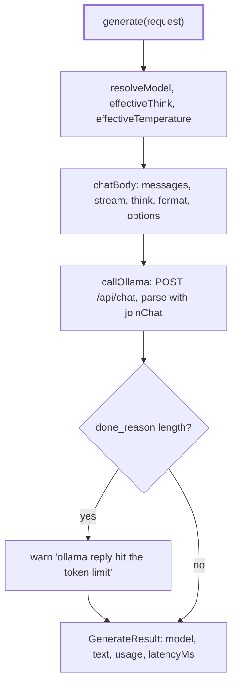

# Chat

> `generate` for the Ollama adapter: one streamed `/api/chat` call for a role, with the `think`
> and sampling rules. Entry: `generate(context, request) → GenerateResult` (`generate.ts`).

## Flow

## Rules

- Always streamed (`stream: true`): Node's `fetch` drops a response whose headers take over 300 s.
  A stream with no final `done: true` line, or a line of the wrong shape, is a `DigestError`, not retried.
- `think`: the configured value for the role, else `DEFAULT_THINK` (`guardRisk: false`, because
  Granite spends about 65 s thinking), else the field is left out. `false` is a real value.
- Temperature and seed: the request wins, even `0`; else the config or `DEFAULT_TEMPERATURE`
  (`write` 0.2, the rest 0); the provider seed goes with a call that has none.
- `effectiveThink` and `effectiveTemperature` own both rules; `cli/doctor` and the run record call them.
- A reply cut at the token limit is returned as it is, with a warning. Under a JSON schema it can
  never validate, so `generateStructured` sends it to its one repair attempt.

## Files

| File              | Role                                                                                |
| ----------------- | ----------------------------------------------------------------------------------- |
| `generate.ts`     | `generate`, `ChatOptions`, `ChatContext`; the token-limit warning                   |
| `chatBody.ts`     | `chatBody`: the JSON body, request values over the sampling defaults                |
| `chatStream.ts`   | `joinChat`: NDJSON lines to text, counts, stop reason; `CHAT_PATH`                  |
| `chatSettings.ts` | `ThinkSetting`, the `DEFAULT_*` tables, `effectiveThink` and `effectiveTemperature` |

Tests run on the fake `fetch` of `../__fixtures__/ollamaHarness.ts` and the recorded stream.

## Gotchas

- `app/container` and `cli/doctor` import `effectiveThink`, `effectiveTemperature` and `ThinkSetting`
  from `chatSettings.ts`: move or rename them and those two break.
