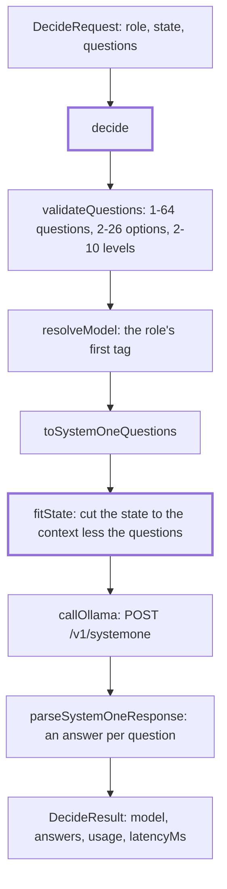

# Decide

> `decide` for the Ollama adapter: typed questions in, probabilities out, in one `/v1/systemone`
> call. Entry: `decide(context, request) → DecideResult` (`decide.ts`). The mapping and the limits
> are in `../systemone.ts`.

## Flow

## Rules

- Questions are checked before any request: a bad set makes no call and costs no retry.
- The model comes from the role, never from the request: a decision model is a profile choice.
- No `think` and no sampling options: the endpoint takes neither, and the log line has no `think`.
- `fitState` keeps the state within the budget less the questions: 48,000 characters, 10,000 for
  `strands-decider` (a 4K context), never under `MIN_STATE_CHARS`. It keeps the head and a tail
  of 10% of the room, so a closing `<<<END DATA>>>` marker survives. A cut logs `decide state trimmed`.
- A missing or mistyped answer throws `DigestError` from `parse` and is not retried.

## Files

| File          | Role                                                                       |
| ------------- | -------------------------------------------------------------------------- |
| `decide.ts`   | `decide`: checks, mapping, the call, the answers                           |
| `fitState.ts` | `fitState(logger, { role, model }, state, questions)`: the cut and its log |

`decide.test.ts` posts the recorded `systemone-request.json`; `fitState.test.ts` calls the cut.

## Gotchas

- One state per call: callers such as `classify` loop over items. Do not add batching here.
- The budgets and `MIN_STATE_CHARS` belong to `../systemone.ts`; this folder only applies them.
