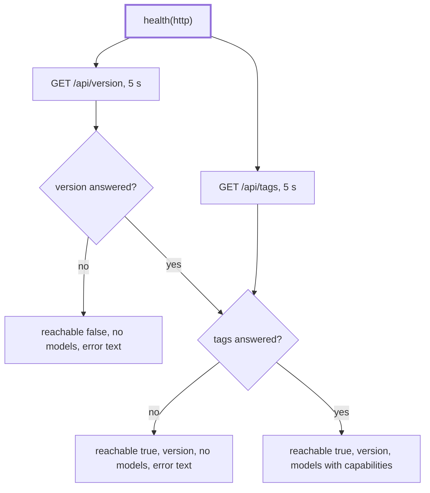

# Health

> `health` for the Ollama adapter: the server version and the installed models, as a result and
> never as an error. Entry: `health(http) → ModelHealth` (`health.ts`). `runDigest` and
> `cli/doctor` call it through the port.

## Flow

## Rules

- It never throws: every failure becomes a `ModelHealth`, so a caller can print what is wrong.
- No version means unreachable; a version with failing tags means reachable with no models.
- Both requests start at once. Each has 5 s and no retry: a hung server gets an answer in 5 s.
- The error text names the cause: a refused connection gets the "Start the Ollama app" message,
  a timeout says it did not answer within 5000 ms, anything else keeps its own message.
- A model without `capabilities` gets `[]`. `cli/doctor` checks for `decision` in it.

## Files

| File        | Role                                                        |
| ----------- | ----------------------------------------------------------- |
| `health.ts` | `health`, the two paths, the reply schemas, the error texts |

`health.test.ts` calls `health` on the fake `fetch` of `../__fixtures__/ollamaHarness.ts`, with
`version.json` and `tags.json` recorded from Ollama 0.40.4.

## Gotchas

- The error texts are shown to the user by `cli/doctor` and pinned by tests.
- It takes the `OllamaHttp` client, not the options: it needs no profile, logger or retry setting.
