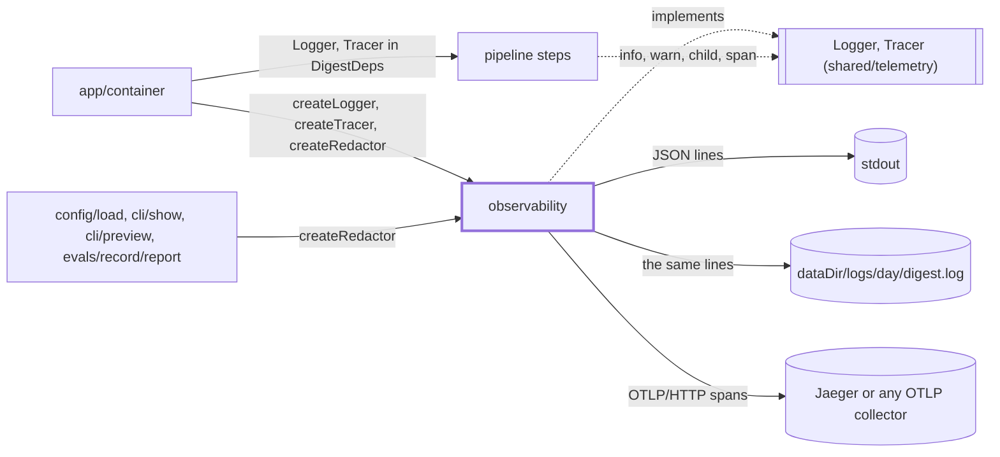
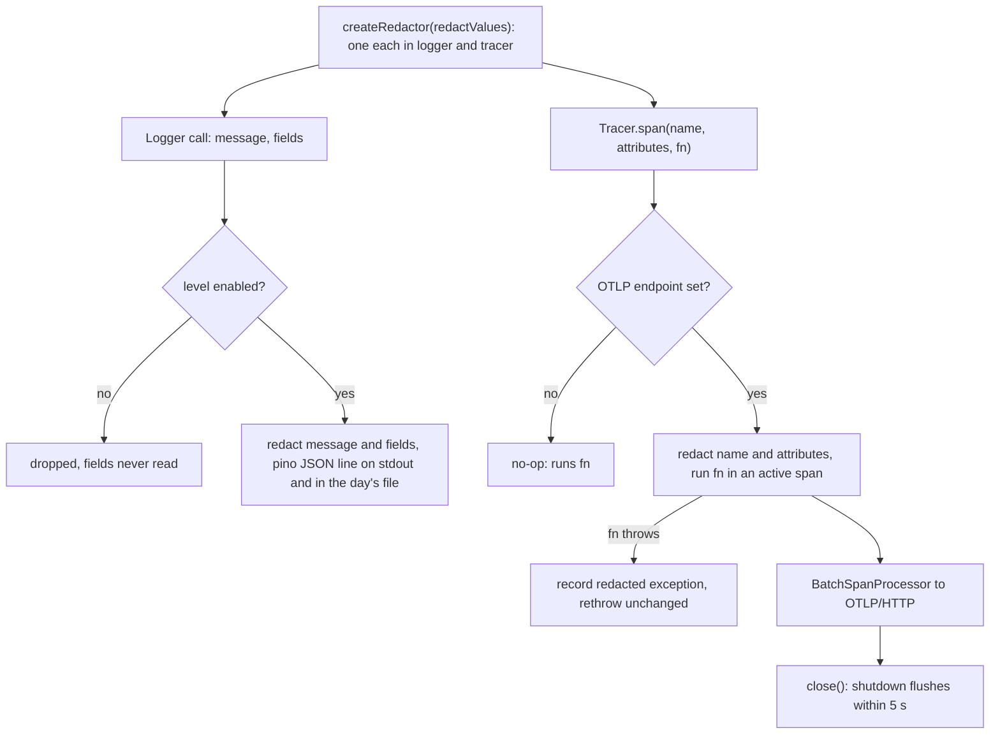

# Observability

> The real `Logger` and `Tracer`: pino JSON logs (on stdout and in a file per day), optional
> OpenTelemetry traces, and the redactor both write through. The pipeline sees only the
> `shared/telemetry` interfaces; `app/container` wires this. Entry: `createLogger(options)`,
> `createTracer(options) → TracingHandle`, `createRedactor(secrets)`.

## Context

## Flow

- The day file is `<dataDir>/logs/<day>/digest.log`, `<day>` the line's date in `schedule.timeZone`
  (`dayOf`). `createAppLogger` (`app/container.ts`) sets it for runs and `digest eval`; other callers log to stdout only.
- Tracing is on only when `OTEL_EXPORTER_OTLP_ENDPOINT` is set (Compose `tracing` profile: Jaeger UI
  `127.0.0.1:16686`). `LOG_LEVEL` sets the level, default `info`.
- Spans of a real run: `runDigest` (`runId`, `dryRun`), one per step (`runId`, `step`), `deliver` on a
  resumed run, `model.generate` / `model.decide` with an inner `model.usage` (`app/tracedModel.ts`).

## Rules

- Redact by value, not by key name: each secret, its percent-encoded and JSON-escaped form become
  `[redacted]`, longest first. Everything written is redacted first: message, field names and values,
  `child` bindings, span name, attribute keys and values, exception, status message.
- The redactor never throws and never mutates its input, so a log call cannot break the pipeline: an
  unreadable bag becomes `{ fields: '[unserializable]' }`, depth over 10 `[truncated]`, a cycle
  `[circular]`, binary `[binary N bytes]`. A telemetry failure never replaces the caller's error.
- One live tracer: OpenTelemetry keeps a process-wide provider, so `createTracer` with an endpoint
  throws until the earlier `shutdown()` finished. `shutdown()` waits at most `shutdownTimeoutMs`
  (5000), then rejects; `container.close()` logs a warning, never fails.
- The day file is `dailyLogFile.ts`: lines are appended one by one, synchronously, so they keep their
  order and survive an exit. A removed logs folder is made again and the line retried once. A write
  that still fails, or an unknown time zone, never throws: it is reported once on stderr.
- Span attributes keep strings, numbers, booleans and arrays of one primitive kind; else JSON text.

## Files

| File              | Role                                                                                           |
| ----------------- | ---------------------------------------------------------------------------------------------- |
| `logger.ts`       | `createLogger`, `LoggerOptions`: pino (`service: "eng-digest"`, ISO time) plus the redactor    |
| `dailyLogFile.ts` | `createDailyLogFile`, `DailyLogFileOptions`: the pino destination that appends to the day file |
| `redact.ts`       | `createRedactor`, `Redactor`; markers `REDACTED`, `CIRCULAR`, `TRUNCATED`, `UNSERIALIZABLE`    |
| `tracing.ts`      | `createTracer`, `TracingHandle`, `TracerOptions`: `NodeTracerProvider` with OTLP, or no-op     |

Tests sit next to each file; they inject a stream as `destination` and an in-memory span `exporter`.

## Gotchas

- `Redactor` is also used by `app/redacting.ts` and `app/redaction/` (run store, deliveries),
  `config/load` (`redactSecrets`), `cli/run`, `cli/fetch`, `cli/doctor`, `cli/show`, `cli/preview` and `evals/record/report/reportLogger.ts`.
- The span attributes `runId` and `step` also pick the per-run logger (`scopeRuns` in `app/container.ts`).
- `logger.test.ts` pins the line shape (ISO `time`, `level` label, `service`, no `pid`) and that `%s` in
  a message stays verbatim: call pino with the message as its only string.
- Tracing tests must `await handle.shutdown()`: a second live tracer throws. Never pass prompts, answers
  or collected text as fields or attributes (`src/models/CLAUDE.md`).
