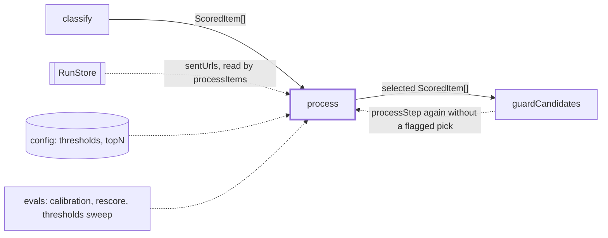
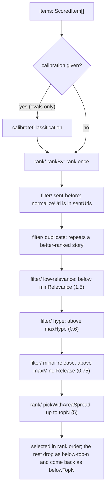

# Process

> Picks the 3-5 items for the writers: drops what was sent, repeated or weak, then ranks the rest
> and spreads them across areas. Plain code, no model: the same input gives the same output.
> Entry: `processStep({ items, sentUrls, thresholds, topN, calibration?, pairwiseOrder?, boostUrls? })` →
> `{ selected, dropped, belowTopN, eligible }`
> (`process.ts`). The chain step is `process`; `src/select/` is the judge, a different feature.

## Context

## Flow

- An item gets the first reason that fits. `dropped` lists reasons in stage order, then
  `below-top-n`. A value equal to a threshold is kept.
- `boostUrls` (normalized URLs of items kept from an earlier run, set by the caller) wins relevance
  ties only; `eligible` is every item that passed the filters, in rank order (`selected` plus
  `belowTopN`).
- Rank order (`byRank`, `pairwiseOrder`, `boostUrls`) and the area spread are in `rank/CLAUDE.md`.

## Rules

- Pure and deterministic: no model, `node:fs`, clock or network. Input order and the machine's
  locale do not matter (`compareStrings` compares by code unit, never `localeCompare`).
- Drop order is a contract (`process.test.ts` and `filter/filterStages.test.ts` pin it). `sent-before`
  runs first so a sent copy cannot hide a fresh one; `duplicate` runs before the thresholds so a
  filtered winner takes its story with it.
- `duplicate`: same id, or from a different source the same normalized title or release key. Items
  of one source never merge. A blank key never matches. The key is narrow on purpose (see
  `dedupe/CLAUDE.md`): a missed merge is left to the writer, a wrong merge drops real news.
- The score thresholds live once, in `filter/thresholds.ts` (`passesThresholds`).
- `topN` must be a whole number of 0 or more, else `DigestError` (step `process`).
- Calibration (`calibration.ts`: a monotone map plus a per-area bias, clamped to 0-3, fitted by
  `evals/calibrate.ts`) and `pairwiseOrder` (`rescoreReplay.ts --pairwise on`, failed its keep
  rule) are evals only: the digest's `processItems` passes neither.

## Files

| File               | Role                                                                           |
| ------------------ | ------------------------------------------------------------------------------ |
| `process.ts`       | `processStep`, `ProcessInput`, `ProcessOutput`, `assertTopN`: the orchestrator |
| `types.ts`         | `Entry`, `Dropped`, `DropReason`: what the three folders share                 |
| `normalizeText.ts` | `normalizeText`: the comparison key for titles, product names and areas        |
| `calibration.ts`   | `CalibrationSchema`, `calibrateClassification`, `areaKey`                      |
| `filter/`          | The drop stages and the score thresholds. See `filter/CLAUDE.md`               |
| `dedupe/`          | Sent-URL test, duplicate detection, the release key. See `dedupe/CLAUDE.md`    |
| `rank/`            | Ranking, the pairwise order, the area-spread pick. See `rank/CLAUDE.md`        |

Tests sit next to each file; `__fixtures__/processKit.ts` has `scored`, `story` and the entry helpers.
`process.test.ts` pins how the three folders work together.

## Gotchas

- The quiet rule is not here. `processItems` (`src/digest/stages/processItems.ts`) ends the run
  `quiet` when fewer than `DIGEST_MIN_ITEMS` (3, `checks/formatCheck.ts`) are selected, and sets
  `counts.afterProcess` to `selected` plus the `below-top-n` drops, matched by that name.
- `evals/thresholds/sweep/keepsItem.ts` calls `passesThresholds`, so the sweep and this step share
  one rule; its test still runs `processStep` on a table of items to pin that.
- `areaKey` (trim, lowercase) keys `areaBias`; the spread uses `normalizeText`: not the same grouping.
- `digest/stages/guardCandidates.ts` calls `processStep` once per batch of guard flags, with the
  flagged items left out, and takes `selected` and `belowTopN` as they are: the step tells items
  apart by identity, so both must stay the very objects it was given.
- Evals call `processStep` too (`calibration/measure/`, `rescore/replay/`, `keepsItem.test.ts`): keep its
  path and signature.
