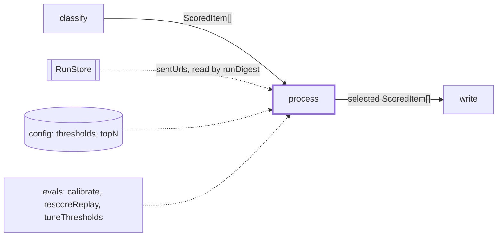
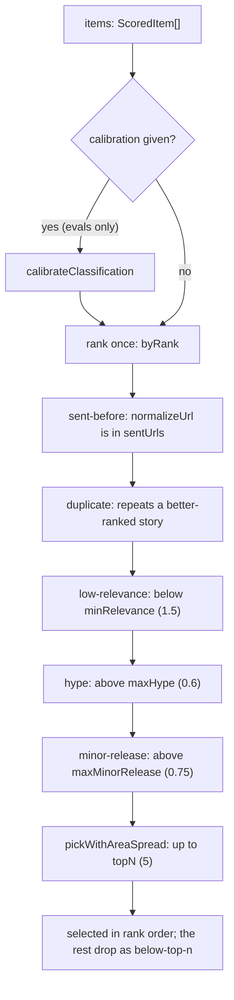

# Process

> Picks the 3-5 items for the writers: drops what was sent, repeated or weak, then ranks the rest
> and spreads them across areas. Plain code, no model: the same input gives the same output.
> Entry: `processStep({ items, sentUrls, thresholds, topN, calibration?, pairwiseOrder? })` →
> `{ selected, dropped }`
> (`process.ts`). The chain step is `process`; `src/select/` is the judge, a different feature.

## Context

## Flow

- An item gets the first reason that fits. `dropped` lists reasons in stage order, then
  `below-top-n`. A value equal to a threshold is kept.
- `byRank`: relevance, `areaConfidence`, newest `publishedAt` (unparseable is oldest), then id.
  Items listed in `pairwiseOrder` rank first, by position; the rest by `byRank`.
- Area spread: an area gets at most 2 slots (`MAX_SLOTS_PER_AREA`) while another area still has an
  item; once every area is full, the least-filled area goes first, then rank. Areas compare after
  `normalizeText`, so case, spacing and punctuation do not split one.

## Rules

- Pure and deterministic: no model, `node:fs`, clock or network. Input order and the machine's
  locale do not matter (`compareStrings` compares by code unit, never `localeCompare`).
- Drop order is a contract (`process.test.ts` pins it). `sent-before` runs first so a sent copy
  cannot hide a fresh one; `duplicate` runs before the thresholds so a filtered winner takes its
  story with it. `sent-before` normalizes both sides, so a tracked URL in an old record matches.
- `duplicate`: same id, or from a different source the same normalized title or release key. Items
  of one source never merge. A blank key never matches.
- The release key (`releaseKeyOf`) is `product@version` from the title (a blog post and a GitHub
  release of one tag), only when the rest of the title announces the release and names no other
  version. Narrow on purpose: a missed merge is left to the writer, a wrong merge drops real news.
- `topN` must be a whole number of 0 or more, else `DigestError` (step `process`).
- Calibration (`calibration.ts`: a monotone map plus a per-area bias, clamped to 0-3, fitted by
  `evals/calibrate.ts`) and `pairwiseOrder` (`rescoreReplay.ts --pairwise on`, failed its keep
  rule) are evals only: `runDigest` passes neither.

## Files

| File             | Role                                                                                      |
| ---------------- | ----------------------------------------------------------------------------------------- |
| `process.ts`     | `processStep`, `ProcessInput`, `ProcessOutput`; ranking, drop stages, release key, spread |
| `calibration.ts` | `CalibrationSchema`, `calibrateClassification`, `areaKey`                                 |

Tests sit next to each file and build items with `makeScoredItem` (`test/builders.ts`). No fixtures.

## Gotchas

- The quiet rule is not here. `selectItems` in `src/digest/runDigest.ts` ends the run `quiet` when
  fewer than `DIGEST_MIN_ITEMS` (3, `checks/formatCheck.ts`) are selected, and sets
  `counts.afterProcess` to `selected` plus the `below-top-n` drops, matched by that name.
- `evals/thresholds/sweep/keepsItem.ts` repeats the three threshold rules; its test runs it against
  `processStep` on a grid and fails when they drift: change both.
- `areaKey` (trim, lowercase) keys `areaBias`; the spread uses `normalizeText`: not the same grouping.
- Before touching `releaseKeyOf`, write a failing test for the new duplicate case. Keep
  `VERSION_TOKEN` linear on hostile titles: `stays fast on hostile titles` times it.
- `process.ts` is 348 lines (cap 300): move the duplicate and release-key code out before adding.
