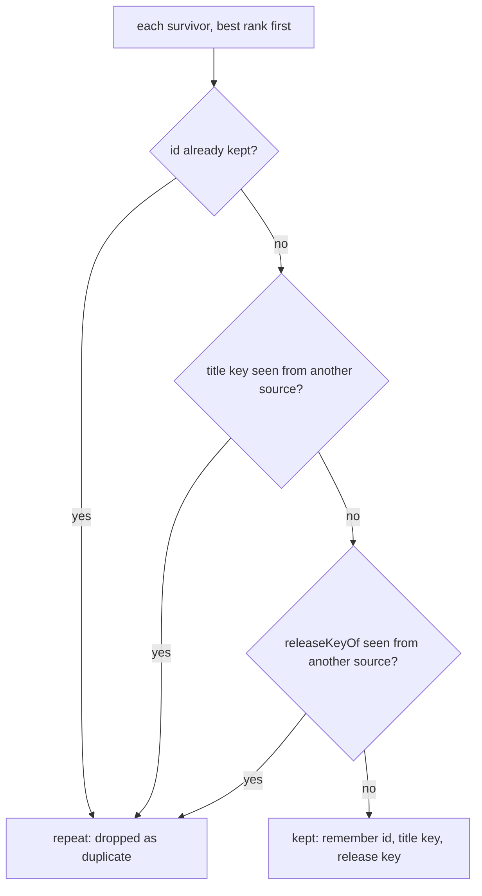

# Process dedupe

> Finds the entries the digest already has: a URL sent in a recent week, or a story another source
> repeats. Entry: `sentBefore(sentUrls) → (entry) → boolean` (`sentBefore.ts`) and
> `duplicates(survivors) → (entry) → boolean` (`duplicates.ts`). No port: pure code.

## Flow

## Rules

- The first entry of a story wins, so `survivors` must be in rank order. Entries of one source
  never merge, and a blank key matches nothing.
- The release key is `product@version`, only when what follows the version announces the release
  and the title names no other version. Narrow on purpose: a missed merge is left to the writer, a
  wrong merge drops real news.
- `sentBefore` normalizes both sides (`normalizeUrl`): a tracked URL in an old record still matches.
- `VERSION_TOKEN` stays linear on hostile titles: `releaseKey.test.ts` times four of them.

## Files

| File            | Role                                                                                |
| --------------- | ----------------------------------------------------------------------------------- |
| `sentBefore.ts` | `sentBefore`: the sent-URL test                                                     |
| `duplicates.ts` | `duplicates`: same id, same title or same release from another source               |
| `releaseKey.ts` | `releaseKeyOf`: the key; private version regex, filler and announcement word tables |

Tests sit next to each file; `releaseKey.test.ts` is a table of real feed titles.

## Gotchas

- Before touching `releaseKeyOf`, add a failing row to `releaseKey.test.ts`: one for the title that
  must merge, one for the story it must not eat. A word added to `ANNOUNCEMENT_WORDS` widens merges.
- `normalizeText` is in `../normalizeText.ts` because `rank/` groups areas with it too: changing it
  moves title keys and area groups together.
