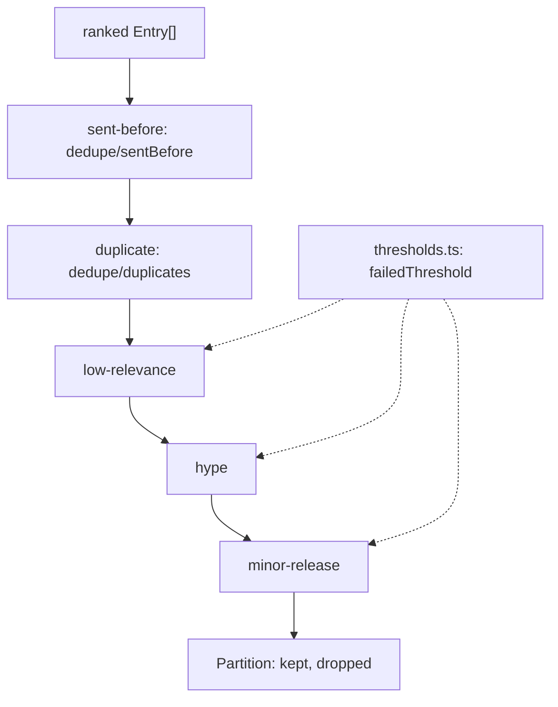

# Process filter

> The drop rules in contract order, and the one definition of the score thresholds.
> Entry: `filterStages(sentUrls, thresholds) → Stage[]` (`filterStages.ts`), folded over the ranked
> entries by `applyStage`; `passesThresholds(classification, thresholds)` (`thresholds.ts`) is the
> keep test alone. No port: pure code.

## Flow

## Rules

- An item gets the first reason that fits, and `dropped` lists reasons stage by stage, in rank order
  inside a stage: callers and `process.test.ts` read that order.
- `sent-before` runs first so a sent copy cannot hide a fresh one. `duplicate` runs before the
  thresholds so a filtered winner takes its story with it.
- The three score rules are written once, in `thresholds.ts`. A value equal to its limit is kept
  (`<` and `>`, never `<=`). Limits come from the `Thresholds` argument; no number lives here.
- This folder imports `../dedupe/`, never the other way, and never `../process.ts`.

## Files

| File              | Role                                                                                  |
| ----------------- | ------------------------------------------------------------------------------------- |
| `filterStages.ts` | `filterStages`: the five stages in order, the threshold ones built from `thresholds`  |
| `applyStage.ts`   | `applyStage`, `drop`, `Stage`, `Partition`                                            |
| `thresholds.ts`   | `passesThresholds`, `failedThreshold`, `THRESHOLD_REASONS`: the score rules, in order |

Tests sit next to each file and build items with `scored` (`../__fixtures__/processKit.ts`).

## Gotchas

- `evals/thresholds/sweep/keepsItem.ts` repeats the three rules; its test runs it against
  `processStep` and fails on drift. Until it calls `passesThresholds`, change both.
- Do not merge the threshold stages into one pass: `dropped` would list by item, not by stage.
