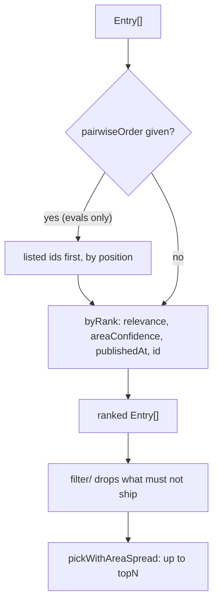

# Process rank

> Orders the entries and picks the top N with an area spread.
> Entry: `rankBy(pairwiseOrder?) → compare(a, b)` (`rankBy.ts`), sorted once up front, and
> `pickWithAreaSpread(ranked, topN) → Set<Entry>` (`pickWithAreaSpread.ts`). No port: pure code.

## Flow

- Area spread: an area gets at most 2 slots (`MAX_SLOTS_PER_AREA`) while another area still has an
  item; once every area is full, the least-filled area goes first, then rank.

## Rules

- `byRank` is a total order: ties fall through areaConfidence, newest `publishedAt` (unparseable is
  oldest), id, source, title and URL. The winner never depends on input order.
- Strings compare by code unit (`compareStrings`), never `localeCompare`: the machine's locale must
  not change a digest.
- Areas compare after `normalizeText`, so case, spacing and punctuation do not split one.
- Ids in `pairwiseOrder` rank by position before any unlisted item; unlisted ones keep `byRank`.
- Entries are tracked by identity, so two items with equal ids stay apart.

## Files

| File                    | Role                                                                |
| ----------------------- | ------------------------------------------------------------------- |
| `rankBy.ts`             | `rankBy`, `byRank`; private `publishedMs`, `compareStrings`         |
| `pickWithAreaSpread.ts` | `pickWithAreaSpread`: the greedy pick; private `MAX_SLOTS_PER_AREA` |

Tests sit next to each file and build items with `scored` (`../__fixtures__/processKit.ts`).

## Gotchas

- `pickWithAreaSpread` expects a ranked list and does not sort. It returns a set; the caller
  filters the ranked list by it, which keeps the selection in rank order.
- `areaKey` in `../calibration.ts` (trim, lowercase) is not the grouping used here (`normalizeText`).
