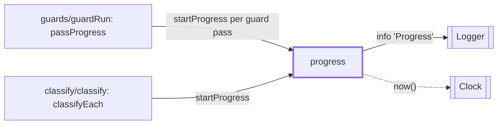

# Progress

> One `Progress` log line now and then while a step works through many items, with done, total,
> the time so far and an estimate of the time left. Entry: `startProgress(options) → { tick }`
> (`progress.ts`). It is not a port: a step calls it with its own `Logger` and `Clock`.

## Context

## Why

On 2026-10-19 the first input guard of a `quality` run took 51 min (147 `guardPolicy` calls of
15 s, clef on a 32 GB M1 Pro) and the log showed one line per call and nothing that said how far
along it was. A call line is per call; this is per step.

## Rules

- A line is due after every 25 items (`PROGRESS_EVERY_ITEMS`) or 60 s (`PROGRESS_EVERY_MS`) since the
  last line, whichever comes first, and always for the last item. Nothing for an empty pool, and
  ticks past the total are ignored.
- The estimate is the median time between two finished items times the items left. The median,
  because the first item of a step often includes loading the model. Time between ticks, not
  between call starts, so it holds for any number of items in flight.
- A line carries `label`, `done`, `total`, `elapsedMs`, `medianMs`, `etaMs` and `eta` (text such as
  `27 min`). `label` is a guard id or `classify`; never an item id, title or any collected text.
- It sits in the step, not in the model adapter: the adapter knows calls, only the step knows how
  many there will be. `guardRun.ts` reports the main pass of each guard (not the rule guard,
  which makes no model call); `classifyEach` reports decide mode.
- Time comes from the `Clock` the step is given (`deps.clock`, the run's clock from the stages), so
  tests step it by hand.

## Files

| File                           | Role                                                             |
| ------------------------------ | ---------------------------------------------------------------- |
| `progress.ts`                  | `startProgress`, `formatDuration`, `PROGRESS_EVERY_ITEMS`, `_MS` |
| `__fixtures__/steppedClock.ts` | `steppedClock`: a `fixedClock` a test moves by hand (`advance`)  |

## Gotchas

- This folder should live in `src/shared/` (small, used by two features). `shared/` is a frozen
  folder on issue branches, so it sits here until a coordinator moves it.
