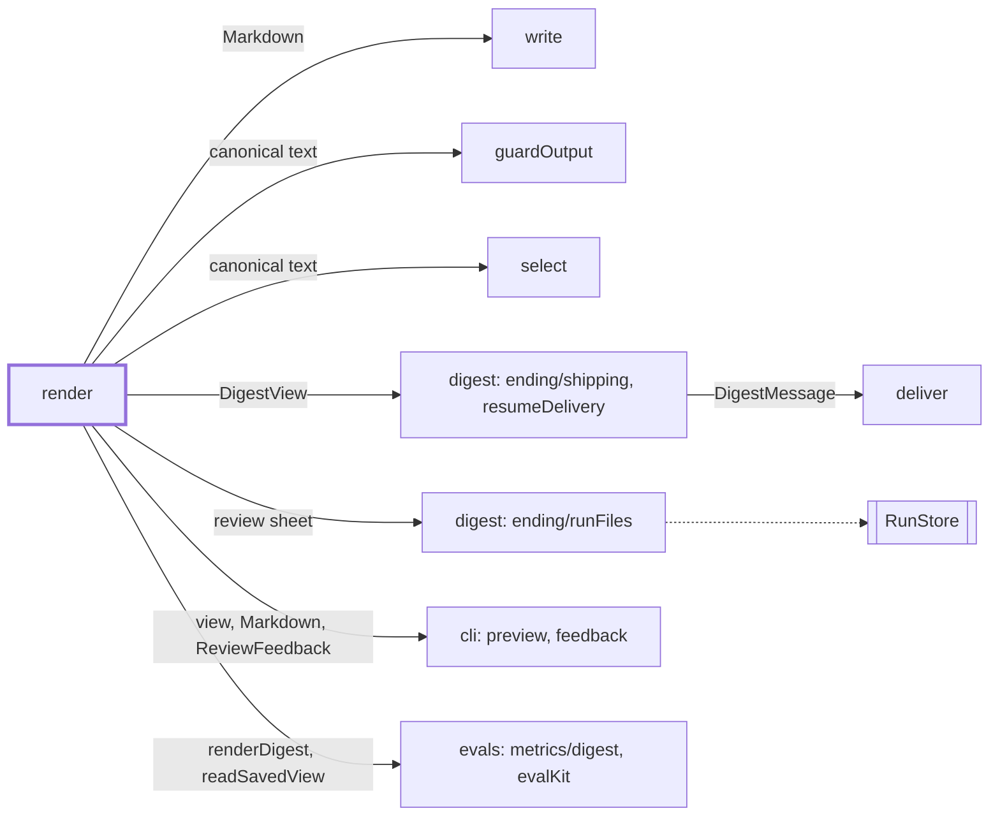
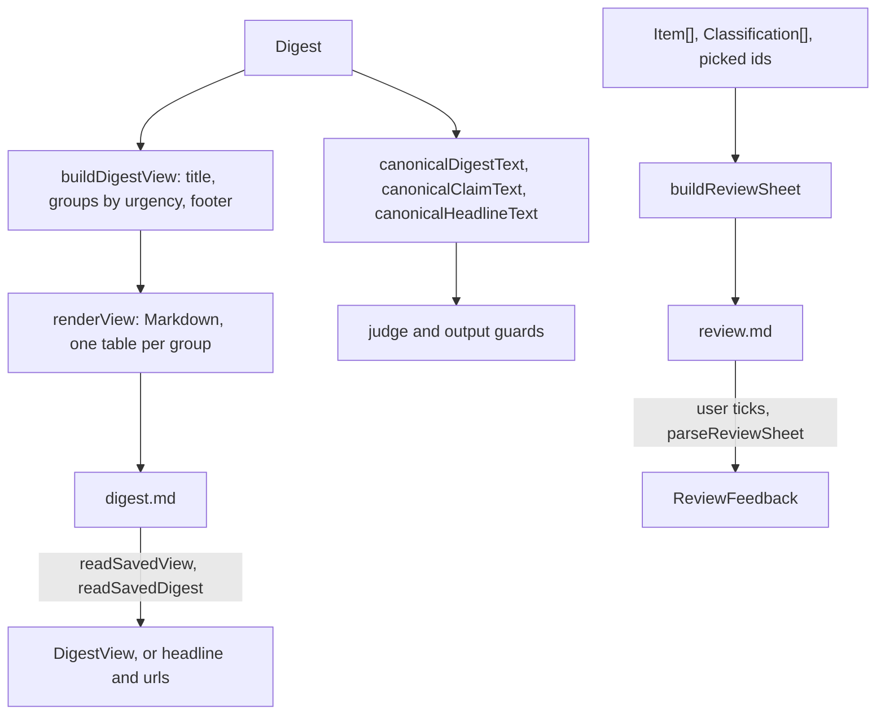

# Render

> Pure views of a digest: a `DigestView` and its Markdown for readers, fixed "canonical" text for
> the judge and guards, a review sheet for the maintainer. It reads a saved `digest.md` back so a
> part-delivered week can resume. Not a chain step, no port.
> Entry: `buildDigestView(digest, options) → DigestView` (`layout.ts`).

## Context

## Flow

- The view has a title computed in code ("Week 2026-W42: 5 releases, 1 needs action"), the model's
  headline, groups in order act-now, worth-a-look, good-to-know (empty ones dropped) and a footer:
  the template-digest note, then the guards that were off. No `urgency` counts as worth-a-look.
- Markdown: `# title`, `_headline_`, then per group `## <marker> <label>` and a table, then `---`
  and the footer. Good-to-know has no action column. The intro is not shown.
- `readSavedDigest` (`{ headline, urls }`) also reads the layout before urgency (`# headline`,
  `[Source](url)` lines), so a week part-delivered across an upgrade resumes.

## Rules

- Pure: no I/O, no model call, inputs unchanged. Titles, labels and the footer come from code.
- Model text must not break a table or hide a link: `cell` makes it one line and escapes pipes; link
  text and destination are escaped so `linkCheck` decodes the same URL. A blank title shows the URL.
- Reading back undoes exactly what rendering escapes and never throws. A group's urgency comes from
  its marker, the label as written; an unknown heading is skipped. Lookbehinds keep backslash runs
  linear. `withoutHeading` drops an action's repeat of its column heading; it is not restored.
- Canonical text takes no options: scoring and guard input stay the same whatever the template. An
  item without urgency or action reads as it did before they existed.
- Review sheet: no model call. Titles are cut to 120 characters, Markdown specials escaped, unsafe
  URL characters percent-encoded. The parser rejects an edited line, a duplicate id or a missing
  section.

## Files

| File             | Role                                                                            |
| ---------------- | ------------------------------------------------------------------------------- |
| `digestView.ts`  | `DigestView`, `DigestViewGroup`, `DigestViewItem`: the view every channel shows |
| `layout.ts`      | `buildDigestView`: grouping, labels, title, footer                              |
| `markdown.ts`    | `renderView`, `renderDigest`, `readSavedView`, `readSavedDigest`, escaping      |
| `canonical.ts`   | `canonicalDigestText`, `canonicalClaimText`, `canonicalHeadlineText`            |
| `reviewSheet.ts` | `buildReviewSheet`, `parseReviewSheet`, `MAX_CANDIDATES`                        |

Tests sit next to each file; `__fixtures__/render/` holds four digests with `.golden.txt` goldens
(Prettier rewrites table pipes in `.md`).

## Gotchas

- The marker, the title shape and the table layout are the saved-file format: `TITLE_LINE` (`markdown.ts`)
  must match `titleOf` (`layout.ts`), and resume must find the item URLs in `digest.md` (rows start
  `| [`) or it refuses until `--force`. If the rebuilt view no longer renders to the file, channels get
  the Markdown without the view. Change writer and reader as one.
- `checks/` counts the Markdown (under 500 words) and reads its links, so template words, links or
  an em dash can fail every draft. `markdown.fixtures.test.ts` runs both checks on the goldens.
- Changing canonical text changes judge and guard input; eval baselines stop comparing.
- Review `rank` is the position in `scores.json`, which `classify` writes in collect order (newest
  first), not by relevance. The 20 candidates are the first left-out items in that order.
