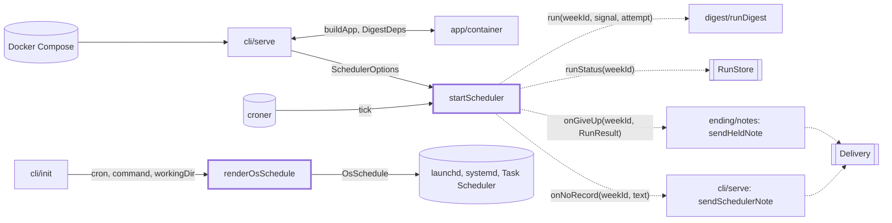
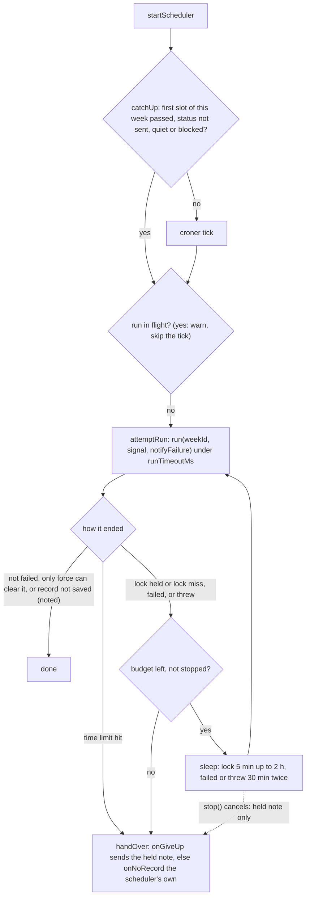

# Scheduler

> Runs the digest every week with no person: the cron loop behind `digest serve`, plus the OS
> schedule text `digest init` prints. Entry: `startScheduler(options) → SchedulerHandle` and
> `renderOsSchedule(os, options) → OsSchedule`. No port: `cli/serve` hands the scheduler `run`,
> `runStatus`, `onGiveUp` and `onNoRecord` as closures.

## Context

## Flow

## Rules

- One run at a time per process. Retries wait in the same tick, so `whenIdle()` covers them.
- A tick never throws: failures are logged and the service stays up, a failing `onGiveUp` or
  `onNoRecord` too.
  A bad cron or time zone throws `DigestError` from `startScheduler`.
- One failure note per failed week: a run that sends its own note at once (time limit, `--force`
  case, `RecordNotSavedError`) is never noted twice, and none of those is retried.
- A run that throws has no record, so nothing else would note the week. It is retried on the
  `failed` budget; a lock miss (`isLockMissError`: "Could not take the run lock", three lost
  races) is retried on the lock budget like a held lock. When no attempt is left the scheduler
  sends its own note through `onNoRecord`: a throw says "stopped before it saved a record" with
  the error's code or class name, a spent lock budget says another run held the lock. It never
  carries error text (paths, secrets, feed text). A held failure note, if any, goes out instead,
  so the week gets one note. `stop()` sends neither: the next start catches the week up.
- Run limit 3 h (zero or less: none). `failedRetry` is off unless given (`serve` passes
  `DEFAULT_FAILED_RETRY`). A wait or limit above 2^31-1 ms counts as off: `setTimeout` would fire at once.
- Catch-up covers only the current ISO week, in `schedule.timeZone`.
- OS schedules take only `m h * * dow` (weekday: `*`, number with 0 and 7 as Sunday, name, list or
  range), else `DigestError`; a new shape needs all three renderers and tests. They fire in the
  machine's time zone, not `schedule.timeZone`. Values are escaped per format; Windows refuses
  `" & | < > ^ %`. The systemd timer is `Persistent`.

## Files

| File            | Role                                                                                          |
| --------------- | --------------------------------------------------------------------------------------------- |
| `scheduler.ts`  | `startScheduler`, `DEFAULT_FAILED_RETRY`, option types; the cron job and the one-run executor |
| `timing.ts`     | `MINUTE_MS`, `HOUR_MS`, `MAX_TIMER_MS`, `isTimerDelay`: what the three folders below share    |
| `retry/`        | The attempt, the wait, the budgets, the held note: see `retry/CLAUDE.md`                      |
| `runLimit/`     | The per-run time limit and its signal: see `runLimit/CLAUDE.md`                               |
| `catchUp/`      | The missed-week check on start: see `catchUp/CLAUDE.md`                                       |
| `simpleCron.ts` | `parseSimpleCron`: the cron subset; `osSchedule.test.ts` covers it, no test file              |
| `osSchedule.ts` | `renderOsSchedule`: launchd (`darwin`), systemd (`linux`), `schtasks` (`win32`)               |

`scheduler.runDigest.test.ts` runs it on the real `runDigest` and run store. No fixtures. Reader page:
`docs/features/scheduler.md`.

## Gotchas

- Read `retry/runWithRetries.giveUp.test.ts` and `.notify.test.ts` before touching the retry loop.
  `retry/runWithRetries.failedRetry.test.ts` pins `DEFAULT_FAILED_RETRY`;
  `test/integration/schedulerRestart.test.ts` also runs the scheduler.
- `stop()` must not abort a run in flight; `serve` does that on a second signal. Retries hang on
  `isUnretriable`, `needsForce` (`digest/ending/notes/unretriable.ts`), `RecordNotSavedError`
  (`digest/ending/saveRecord.ts`), `RunResult` (`digest/types.ts`) and `isLockHeldError`
  (`store/lockHeld.ts`). `cli/serve` passes `sendHeldNote` (`digest/ending/notes/`) as `onGiveUp`
  and `sendSchedulerNote` as `onNoRecord`. The lock-miss text is the adapter's
  (`store/adapters/runLock.ts`); `retry/lockMiss.test.ts` fails if it changes.
- `cli/serve` and `schedulerRestart.test.ts` import `CronFactory`, `LockRetry`, `SchedulerOptions` and
  the entry points from `scheduler.ts`: keep them exported there. No folder source imports it.
