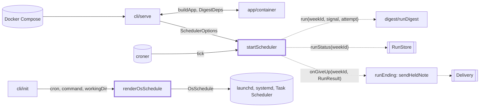
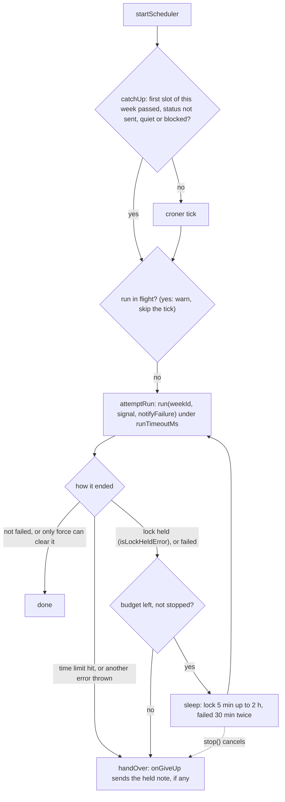

# Scheduler

> Runs the digest every week with no person: the cron loop behind `digest serve`, plus the OS
> schedule text `digest init` prints. Entry: `startScheduler(options) → SchedulerHandle` and
> `renderOsSchedule(os, options) → OsSchedule`. No port: `cli/serve` hands the scheduler `run`,
> `runStatus` and `onGiveUp` as closures.

## Context

## Flow

- Held note: with `onGiveUp` set, an attempt that will be retried gets `notifyFailure: false`. If
  the retry never comes, `onGiveUp(weekId, lastResult)` sends the one note that was held back.

## Rules

- One run at a time per process. Retries wait in the same tick, so `whenIdle()` covers them.
- A tick never throws: failures are logged and the service stays up, a failing `onGiveUp` too.
  A bad cron or time zone throws `DigestError` from `startScheduler`.
- One failure note per failed week: a run that sends its own note at once (time limit, `--force` case,
  `RecordNotSavedError`) is never noted twice. Those and any other thrown error are not retried;
  after a time limit, another try takes as long and a hung model is no blip.
- Run limit 3 h (zero or less: none). `failedRetry` is off unless given (`serve` passes
  `DEFAULT_FAILED_RETRY`): a retry keeps `whenIdle()` waiting. A wait or limit above 2^31-1 ms counts
  as off, since `setTimeout` would fire at once.
- Catch-up covers only the current ISO week, in `schedule.timeZone`.
- OS schedules take only `m h * * dow` (weekday: `*`, number with 0 and 7 as Sunday, name, list or
  range), else `DigestError`; a new shape needs all three renderers and tests. They fire in the
  machine's time zone, not `schedule.timeZone`. Values are escaped per format; Windows refuses
  `" & | < > ^ %`. The systemd timer is `Persistent`.

## Files

| File            | Role                                                                                          |
| --------------- | --------------------------------------------------------------------------------------------- |
| `scheduler.ts`  | `startScheduler`, `DEFAULT_FAILED_RETRY`, option types; the cron job and the one-run executor |
| `timing.ts`     | `MINUTE_MS`, `HOUR_MS`, `MAX_TIMER_MS`, `isTimerDelay`: what the three folders below share    |
| `retry/`        | The attempt, the wait, the budgets, the held note: see `retry/CLAUDE.md`                      |
| `runLimit/`     | The per-run time limit and its signal: see `runLimit/CLAUDE.md`                               |
| `catchUp/`      | The missed-week check on start: see `catchUp/CLAUDE.md`                                       |
| `simpleCron.ts` | `parseSimpleCron`: the cron subset; `osSchedule.test.ts` covers it, no test file              |
| `osSchedule.ts` | `renderOsSchedule`: launchd (`darwin`), systemd (`linux`), `schtasks` (`win32`)               |

`scheduler.test.ts` covers ticks, the handle and the real cron; `scheduler.runDigest.test.ts` runs
it on the real `runDigest` and run store. No fixtures. Reader page: `docs/features/scheduler.md`.

## Gotchas

- Read `retry/runWithRetries.giveUp.test.ts` and `.notify.test.ts` before touching the retry loop (a
  failed week must never end without one note). Tests inject `cronFactory`, `fixedClock` and fake
  `setTimeout`. `retry/runWithRetries.failedRetry.test.ts` pins `DEFAULT_FAILED_RETRY`;
  `test/integration/schedulerRestart.test.ts` also runs the scheduler.
- `stop()` must not abort a run in flight; `serve` does that on a second signal. Retries also hang on
  `isUnretriable`, `needsForce` and `sendHeldNote` in `digest/runEnding`, `RunResult` in
  `digest/runDigest`, and a lock miss on `isLockHeldError` in `store/adapters/lockState/`.
- `cli/serve` and `schedulerRestart.test.ts` import `CronFactory`, `LockRetry`, `SchedulerOptions`
  and the entry points from `scheduler.ts`: keep them exported there. No folder code imports it.
