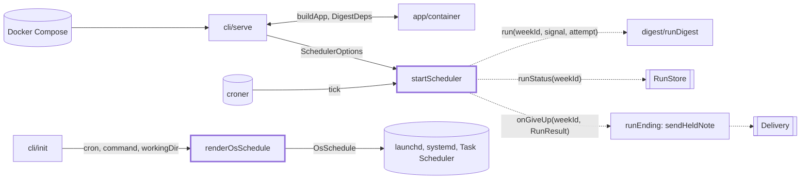
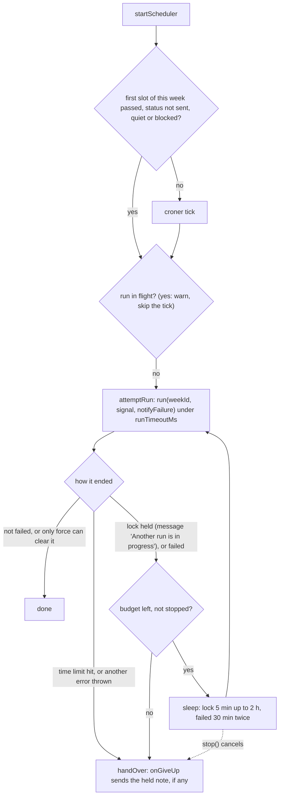

# Scheduler

> Runs the digest every week with no person: the cron loop behind `digest serve`, plus the OS
> schedule text `digest init` prints. Entry: `startScheduler(options) → SchedulerHandle` and
> `renderOsSchedule(os, options) → OsSchedule`. No port: `cli/serve` hands the scheduler `run`,
> `runStatus` and `onGiveUp` as closures.

## Context

## Flow

- Held note: with `onGiveUp` set, an attempt that will be retried gets `notifyFailure: false`. If
  the retry never comes, `onGiveUp(weekId, lastResult)` sends the one note that was held back.

## Rules

- One run at a time per process. Retries wait in the same tick, so `whenIdle()` covers them.
- A tick never throws: failures are logged and the service stays up, a failing `onGiveUp` too.
  A bad cron or time zone throws `DigestError` from `startScheduler`.
- One failure note per failed week: a run that sends its own note at once (time limit, `--force` case,
  `RecordNotSavedError`) is never noted twice. Those and any other thrown error are not retried;
  after a time limit, another try takes as long and a hung model is no blip.
- Run limit 3 h (zero or less: none). `failedRetry` is off unless given (`serve` passes
  `DEFAULT_FAILED_RETRY`): a retry keeps `whenIdle()` waiting. A wait or limit above 2^31-1 ms counts
  as off, since `setTimeout` would fire at once.
- Catch-up covers the current ISO week in `schedule.timeZone`; `failed` and `dry-run` weeks run
  again. It searches from Monday 00:00 UTC minus 14 h so a UTC+14 zone finds its slot. An
  unreadable run store skips it. The run is not awaited: the caller needs the handle to stop.
- OS schedules take only `m h * * dow` (weekday: `*`, number with 0 and 7 as Sunday, name, list or
  range), else `DigestError`; a new shape needs all three renderers and tests. They fire in the
  machine's time zone, not `schedule.timeZone`. Values are escaped per format; Windows refuses
  `" & | < > ^ %`. The systemd timer is `Persistent`.

## Files

| File            | Role                                                                                |
| --------------- | ----------------------------------------------------------------------------------- |
| `scheduler.ts`  | `startScheduler`, `DEFAULT_FAILED_RETRY`, option types; executor, retries, catch-up |
| `simpleCron.ts` | `parseSimpleCron`: the cron subset; `osSchedule.test.ts` covers it, no test file    |
| `osSchedule.ts` | `renderOsSchedule`: launchd (`darwin`), systemd (`linux`), `schtasks` (`win32`)     |

## Gotchas

- `scheduler.ts` is 582 lines, over the 300 cap. Split the retry loop and catch-up out first.
- Read `scheduler.giveUp.test.ts` and `scheduler.notify.test.ts` before touching the retry loop (a
  failed week must never end without one note). Tests inject `cronFactory`, `fixedClock` and fake
  `setTimeout`. More sit in `src/app/scheduler{Retry,RunDigest}.test.ts` (they pin
  `DEFAULT_FAILED_RETRY`) and `test/integration/schedulerRestart.test.ts`.
- `stop()` must not abort a run in flight; `serve` does that on a second signal. Retries also hang on
  `RunResult`, `isUnretriable`, `needsForce` and `sendHeldNote` in `digest/runEnding`, and on the
  lock message in `store/adapters/runLock.ts`: keep both strings in step.
