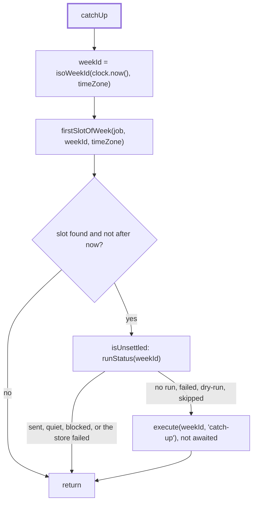

# Catch-up

> Runs the current week at start if the machine missed its slot. Entry:
> `catchUp(job, settings, execute) → Promise<void>` (`catchUp.ts`). `startScheduler` calls it once,
> before it returns the handle. Reads the run store through the `runStatus` closure.

## Flow

## Rules

- Only the current ISO week in `schedule.timeZone`. Older missed weeks are not run.
- `firstSlotOfWeek` asks the cron from Monday 00:00 UTC minus 14 h minus 1 ms (`MAX_UTC_OFFSET_MS`):
  a zone as far ahead as UTC+14 has its Monday before UTC does, and `nextRun` is strictly after.
- `SETTLED` (`sent`, `quiet`, `blocked`) is left alone. A `failed` or `dry-run` week runs again.
- An unreadable run store logs an error and skips the catch-up. It never throws, so the service
  still starts.
- The run is not awaited: it takes minutes, and the caller needs the handle to be able to stop.

## Files

| File                                         | Role                                                   |
| -------------------------------------------- | ------------------------------------------------------ |
| `catchUp.ts`                                 | `catchUp`, `isUnsettled`, `SETTLED`, `CatchUpSettings` |
| `firstSlotOfWeek.ts`                         | `firstSlotOfWeek`, `MAX_UTC_OFFSET_MS`, `SlotSource`   |
| `catchUp.test.ts`, `firstSlotOfWeek.test.ts` | Each file on its own, with a stub cron                 |
| `catchUp.scheduler.test.ts`                  | The catch-up through `startScheduler`                  |

## Gotchas

- `execute` is the scheduler's executor, so a catch-up run gets the same retries, limit and held
  note as a scheduled one. `trigger: 'catch-up'` shows up in their log lines.
- A cron that skips this week gives a slot in a later week: it is in the future, so nothing runs.
