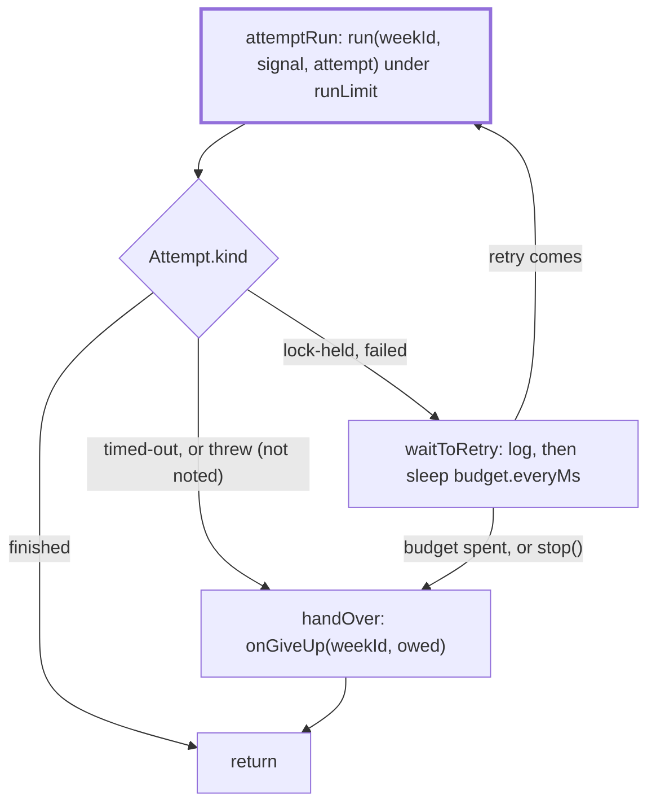

# Retry

> Takes one scheduled week to its end: attempts it, waits and tries again, and sends the one
> failure note a failed week owes. Entry: `runWithRetries(context, weekId, trigger)`, which never
> throws. `scheduler.ts` builds the `RetryContext`.

## Flow

## Rules

- Two budgets, one per reason (`lock-held`, `failed`); a lock miss spends none of the failed ones.
- An attempt gets `notifyFailure: false` (`holds`) while a failed retry is left, `stop()` has not
  come and `onGiveUp` is set. `owed` is the result whose note it held back: a later failed run
  replaces it, a lock miss keeps it, `handOver` sends it when no retry follows.
- A failure owes a note unless the run sent it at once (`isUnretriable`). A time limit and a failure
  only `--force` clears (`needsForce`) are not retried (`digest/ending/notes/unretriable.ts`). A lock
  miss is `isLockHeldError` (`store/lockHeld.ts`): a plain `Error` with the same text is an ordinary throw.

## Files

| File                | Role                                                                       |
| ------------------- | -------------------------------------------------------------------------- |
| `types.ts`          | `Attempt`, `RetryContext`, `RunWeek`, `GiveUp`, `RunAttempt`, `Trigger`    |
| `wait.ts`           | `budgetOf` (off for a wait a timer cannot hold), `createWaiter`, the timer |
| `attemptRun.ts`     | `attemptRun` (one call under the time limit) and `afterRun` (how it ended) |
| `waitToRetry.ts`    | `waitToRetry`; the retry and give-up log texts and the give-up reasons     |
| `handOver.ts`       | `handOver`: sends the held note through `onGiveUp`; never throws           |
| `runWithRetries.ts` | `runWithRetries`: the loop                                                 |

## Gotchas

- `waitToRetry.ts` log texts are quoted in `docs/runbooks/debug/stuck-lock.md`; tests pin them.
- Read `runWithRetries.giveUp.test.ts` and `.notify.test.ts` before changing the loop: a failed week
  must never end without one note, and never with two.
