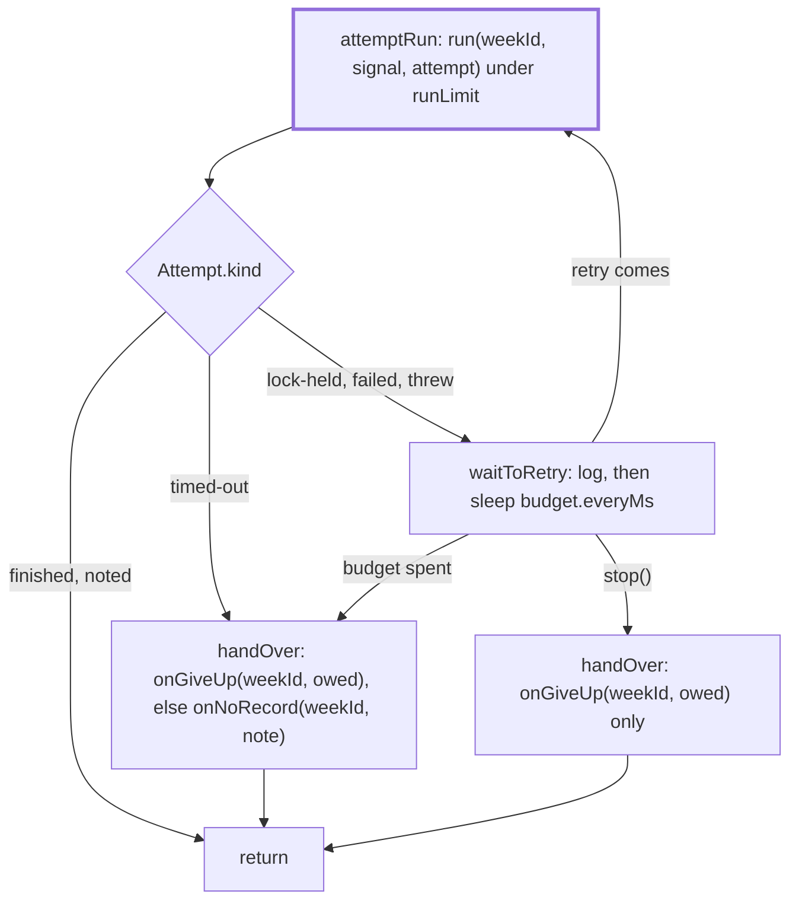

# Retry

> Takes one scheduled week to its end: attempts it, waits and tries again, and sends the one
> failure note a failed week owes (a held one, or its own when the run left no record). Entry:
> `runWithRetries(context, weekId, trigger)`, which never throws. `scheduler.ts` builds the
> `RetryContext`.

## Flow

## Rules

- Two budgets, one per reason (`lock-held`, `failed`); a lock miss spends none of the failed ones.
  A run that `threw` spends the `failed` budget, so with none configured it is noted at once.
- An attempt gets `notifyFailure: false` (`holds`) while a failed retry is left, `stop()` has not
  come and `onGiveUp` is set. `owed` is the result whose note it held back: a later failed run
  replaces it, a lock miss keeps it, `handOver` sends it when no retry follows.
- A failure owes a note unless the run sent it at once (`isUnretriable`). A time limit and a failure
  only `--force` clears (`needsForce`) are not retried (`digest/ending/notes/unretriable.ts`). A lock
  miss is `isLockHeldError` (`store/lockHeld.ts`) or `isLockMissError` (`lockMiss.ts`, "Could not take
  the run lock": the adapter lost three races): a plain `Error` with the same text is an ordinary throw.
- A throw owes a note: `Attempt.threw` carries the text the scheduler composed (`noRecordNote.ts`),
  from the week and `errorLabel` (errno code or class name, never the message). A throw after the
  time limit fired is `timed-out` with that note and is not retried; `RecordNotSavedError` is
  `noted`: the run sent its note. `handOver` sends the held `owed` result when there is one, else
  the note (lock text on a spent lock budget, the throw text on a spent failed budget), never both.
  A `stop()` hands over `owed` only: the next start catches the week up.

## Files

| File                | Role                                                                                          |
| ------------------- | --------------------------------------------------------------------------------------------- |
| `types.ts`          | `Attempt`, `RetryContext`, `RunWeek`, `GiveUp`, `SendNote`, `RunAttempt`, `Trigger`           |
| `lockMiss.ts`       | `isLockMissError`: the lock adapter lost every race for the lock file                         |
| `noRecordNote.ts`   | `errorLabel`, `threwNote`, `lockNote`: the scheduler's own note texts                         |
| `wait.ts`           | `budgetOf` (off for a wait a timer cannot hold), `createWaiter`, the timer                    |
| `attemptRun.ts`     | `attemptRun` (one call under the time limit) and `afterRun` (how it ended)                    |
| `waitToRetry.ts`    | `waitToRetry`; the retry and give-up log texts and the give-up reasons                        |
| `handOver.ts`       | `handOver`: the held note through `onGiveUp`, else its own through `onNoRecord`; never throws |
| `runWithRetries.ts` | `runWithRetries`: the loop                                                                    |

## Gotchas

- `waitToRetry.ts` log texts and `noRecordNote.ts` note texts are quoted in
  `docs/runbooks/debug/stuck-lock.md` and `docs/operations/scheduler.md`; tests pin them.
- Read `runWithRetries.noRecord.test.ts` for the throw and lock-budget notes.
- Read `runWithRetries.giveUp.test.ts` and `.notify.test.ts` before changing the loop: a failed week
  must never end without one note, and never with two.
