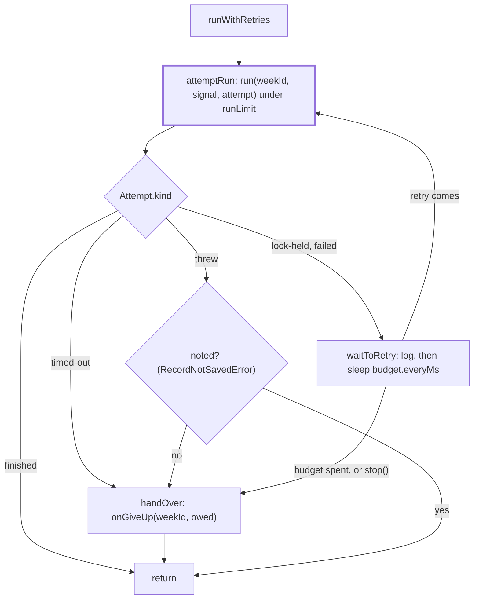

# Retry

> Takes one scheduled week to its end: attempts it, waits and tries again, and sends the one
> failure note a failed week owes. Entry: `runWithRetries(context, weekId, trigger)`, which never
> throws. `scheduler.ts` builds the `RetryContext`.

## Flow

- `holds`: an attempt gets `notifyFailure: false` while a failed retry is left, `stop()` has not
  come and `onGiveUp` is set. `owed` is the failed result whose note it held back: a later failed
  run replaces it, a lock miss keeps it, `handOver` sends it when no retry follows.

## Rules

- Two budgets, one per reason (`lock-held`, `failed`): a lock miss spends none of the failed ones.
  `budgetOf` turns a budget off for a wait of zero, below, NaN or above 2^31-1 ms, or a count below one.
- A failure owes a note only when its attempt held it back and its error is retriable
  (`isUnretriable` false). A time limit and a failure only `--force` clears are never retried.
- A lock miss is `isLockHeldError` (store): a plain `Error` with the same text is an ordinary throw.
- `handOver` never throws: a failing `onGiveUp` is logged, so a tick cannot take the service down.
- `stop()` cancels the wait and ends the loop after a hand-over. It does not abort a run in flight.

## Files

| File                | Role                                                                       |
| ------------------- | -------------------------------------------------------------------------- |
| `types.ts`          | `Attempt`, `RetryContext`, `RunWeek`, `GiveUp`, `RunAttempt`, `Trigger`    |
| `wait.ts`           | `budgetOf` and `Budget`; `createWaiter`, the one cancellable timer         |
| `attemptRun.ts`     | `attemptRun` (one call under the time limit) and `afterRun` (how it ended) |
| `waitToRetry.ts`    | `waitToRetry`; the retry and give-up log texts and the give-up reasons     |
| `handOver.ts`       | `handOver`: sends the held note through `onGiveUp`                         |
| `runWithRetries.ts` | `runWithRetries`: the loop                                                 |

Each file but `types.ts` has a unit test. `runWithRetries.{failedRetry,lockRetry,giveUp,notify}.test.ts`
drive the loop through `startScheduler` with fake timers.

## Gotchas

- `waitToRetry.ts` log texts are quoted in `docs/runbooks/debug/stuck-lock.md`; tests pin them.
- Read `runWithRetries.giveUp.test.ts` and `.notify.test.ts` before changing the loop: a failed
  week must never end without one note, and never with two.
- `isUnretriable`, `needsForce` and `RecordNotSavedError` come from `digest/runEnding`, `RunResult`
  from `digest/runDigest`: a change there changes which failures retry.
