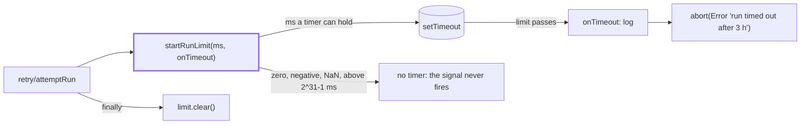

# Run limit

> A time limit for one run. `startRunLimit(ms, onTimeout) → RunLimit` hands out an `AbortSignal`
> that fires after `ms`. `attemptRun` (in `retry/`) starts one per attempt and clears it after.

## Flow

## Rules

- The abort reason is written here: `run timed out after <describeDuration(ms)>`. It ends up in
  `run.json` and the failure note, so it carries the limit and nothing from the run.
- `onTimeout` runs before the abort, so the scheduler logs the limit before the run sees it.
- `describeDuration` picks the largest unit that is whole: `3 h`, `90 min`, `30 s`, `1500 ms`.
- A limit that is not a positive delay a timer can hold means no limit (`isTimerDelay`).
- `clear()` always runs, so a finished or thrown run leaves no timer behind.

## Files

| File                         | Role                                                                      |
| ---------------------------- | ------------------------------------------------------------------------- |
| `runLimit.ts`                | `startRunLimit`, `RunLimit`, `describeDuration`, `DEFAULT_RUN_TIMEOUT_MS` |
| `runLimit.test.ts`           | The limit on its own, with fake timers                                    |
| `runLimit.scheduler.test.ts` | The limit through `startScheduler`: retries, catch-up, `stop()`           |

## Gotchas

- The default is 3 hours and lives here, but `scheduler.ts` applies it (`runTimeoutMs ?? default`).
- A run that hit the limit is never retried. `retry/attemptRun.ts` reads `timedOut()`, and
  `isUnretriable` (`digest/ending/notes/unretriable.ts`) reads the `Run aborted` prefix that `abortedError` adds.
