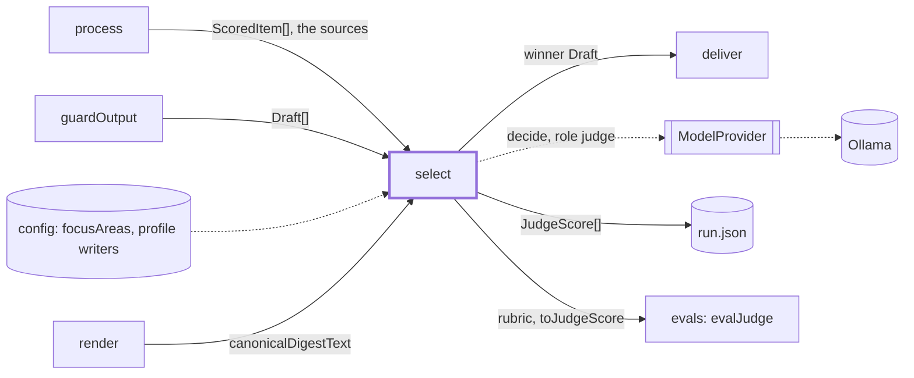
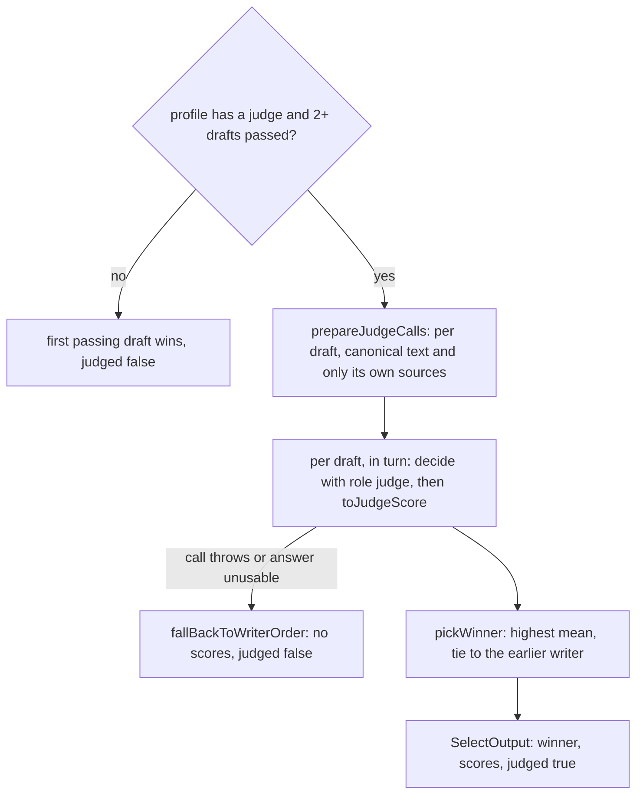

# Select

> Picks the one draft that goes out when more than one passed the checks and the output guards. A
> judge model scores each draft against its own sources; the best mean wins.
> Entry: `selectStep(drafts, sources, deps) → { winner, scores, judged }` (`select.ts`). Uses
> `ModelProvider.decide` with role `judge`.

## Context

## Flow

- The gate is in `digest/stages/selectWinner.ts`. `quality` has a judge (`clef`), as does any profile with a
  `models.writers` override of 2+ writers; `fast` and `light` have none, so
  `evals/judge/evalJudge.ts` judges their winner. `selectStep` also takes one draft (returned
  unjudged) and none (`DigestError`, Blocked).
- Four `JUDGE_CRITERIA` (`accuracy`, `clarity`, `whyItMatters`, `focusFit` with the focus areas),
  each a 5-level question (`JUDGE_LEVELS`, 1 poor to 5 excellent). The answer is a 0-based expected
  level, clamped to 0-4, plus 1; `score` is the mean of the four.
- Scores within `SCORE_TIE_EPSILON` (1e-9) tie. A tie, and the fallback, go to the writer earlier in
  `writerOrder`; unlisted writers rank last, in arrival order.

## Rules

- One call per draft, in turn, never `Promise.all`: one model runs at a time. The judge sees one
  draft and only its own sources, each in its own `wrapUntrusted` block, never another draft or a
  writer's name: no score can leak from or be pulled by a neighbour.
- The judge reads canonical text (`render/canonical.ts`), not Markdown: a new layout does not move
  scores, so eval baselines stay comparable.
- A judge failure never fails the run: one warning (writer, error cut to 300 characters), then the
  first writer in order wins. `prepareJudgeCalls` sits outside the `try` on purpose, so a code bug
  does not hide as an outage. Do not move it in.
- `toJudgeScore` throws `DigestError` (step `select`) on a missing or non-`score` answer or a
  non-finite level. `evals/judge/evalJudge.ts` converts answers with it and reuses the questions,
  `buildJudgeState` and `resolveDraftSources`.
- `winner` is one of the `Draft` objects passed in, never a copy: `selectWinner` finds it by
  identity and throws otherwise. Inputs are not changed.
- Cited ids that were not collected are skipped with a warning. Logs never hold draft text.

## Files

| File             | Role                                                              |
| ---------------- | ----------------------------------------------------------------- |
| `select.ts`      | `selectStep`, `toJudgeScore`, tie-break, fallback                 |
| `judgePrompt.ts` | `JUDGE_CRITERIA`, `JUDGE_LEVELS`, the question and state builders |
| `judgeScore.ts`  | `JudgeScoreSchema`, `JudgeScore`: the type this feature owns      |

Tests sit next to each file and script `decide` answers on `FakeModelProvider`. No fixtures.

## Gotchas

- `JUDGE_CRITERIA` are the keys of `JudgeScore.byCriterion` (saved in `run.json`) and drive the fake
  answers in `test/integration/harness/answers.ts`. A renamed criterion, question or level moves every
  score: re-check `evals/judge/calibrate.ts` and run `evals/judge/evalJudge.test.ts` and
  `evals/judge/judgeInHarness.test.ts`.
