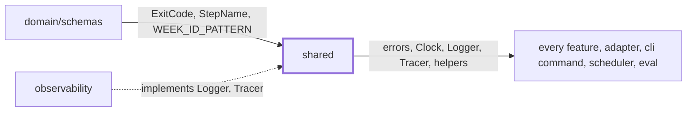
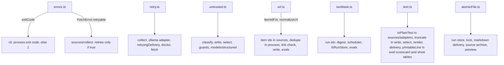

# Shared

> Small helpers many features need and none should own: errors with exit codes, clock, retry and
> timeout, ISO weeks, URL and text cleaning, the untrusted-data wrapper, the `Logger` and `Tracer`
> interfaces, the atomic file writer. Any layer may import them. No entry point, no port.

## Context

## Flow

## Rules

- No state, no feature imports, so any layer can import it. It imports only `domain/schemas`
  (`errors.ts`, `isoWeek.ts`; `domain` never imports `shared`, so no cycle), `node:crypto` (`url.ts`)
  and, in `atomicFile.ts` alone, `node:fs`. Time and sleep are passed in (`Clock`, `sleep`): tests never wait.
- `DigestError.exitCode` becomes the process exit code (default `Failed`, 1); `step` names the step that
  threw. `FetchError` adds `status` and `retryable`, which the fetcher sets (`sources/adapters/http.ts`).
- `itemIdFor` is the first 16 hex chars of sha256 of `normalizeUrl(url)`: ids are saved in digests, run
  folders and eval data, so they must stay stable.
- `normalizeUrl` lowercases the host; drops the default port, fragment, `utm_*` and `ref`, `fbclid`,
  `gclid`, `mc_cid`, `mc_eid`, `source`; sorts the query; strips a trailing slash (not on the root). A
  non-http(s) input comes back trimmed.
- `wrapUntrusted` swaps `<<<` and `>>>` in the text for look-alikes and limits the label to `[\w.:-]`:
  collected text cannot close or open its own data block.
- `isoWeekId` is ISO 8601 (the Thursday sets the year); `weekStartUtc` is Monday 00:00 UTC.
- `toPlainText` stays linear on hostile input (a long run of unclosed `<script>` tags). `truncate` cuts at
  a word when that keeps over half of `maxChars`, adds `...`, never splits a surrogate pair.
- `printableLine` turns each run of Unicode control (`Cc`) and format (`Cf`) characters, U+2028 and U+2029
  into one space, then trims. It matches the classes, not a list of ranges, so a new invisible format
  character is covered. A zero-width joiner counts: a joined emoji prints as its parts.
- `withRetry`: `retries` counts extra tries, delay `baseDelayMs * 2^attempt` up to `maxDelayMs`; a
  fired `signal` ends it at once. `withTimeout` rejects with `TimeoutError` even when `fn` ignores the signal.

## Files

| File            | Role                                                                                                     |
| --------------- | -------------------------------------------------------------------------------------------------------- |
| `atomicFile.ts` | `writeFileAtomic`, `createFileExclusive`, `readTextIfExists`, `removeStaleTempFiles`, `isErrnoException` |
| `clock.ts`      | `Clock`, `systemClock`, `fixedClock` (a fresh `Date` per call)                                           |
| `errors.ts`     | `DigestError`, `FetchError`, `errorMessage`                                                              |
| `isoWeek.ts`    | `isoWeekId`, `parseWeekId`, `weekStartUtc`, `previousWeekIds`, `compareWeekIds`                          |
| `retry.ts`      | `withRetry`, `withTimeout`, `TimeoutError`                                                               |
| `telemetry.ts`  | `Logger`, `Tracer`, `LogFields`, `noopLogger`, `noopTracer`                                              |
| `text.ts`       | `toPlainText`, `truncate`, `wordCount`, `printableLine`                                                  |
| `untrusted.ts`  | `wrapUntrusted`, `neutralize`, `UNTRUSTED_DATA_RULE`, `DATA_OPEN`, `DATA_CLOSE`                          |
| `url.ts`        | `normalizeUrl`, `itemIdFor`, `sameUrl`                                                                   |

Tests sit next to each file, except `clock.ts` and `telemetry.ts`. No fixtures.

## Gotchas

- Frozen on issue branches (`.claude/rules/parallel-work.md`): set the issue to `blocked`, write the
  change under `## Notes`, and let the coordinator make it on `main`.
- Do not change `normalizeUrl` or `itemIdFor` without re-recording: every id in `evals/weeks/`,
  `evals/classifier-cases.json` and `evals/sources/*/expected.json` is such a hash, and
  `evals/dataset.*.test.ts` fail. It also changes what `process` counts as already sent.
- Do not renumber `ExitCode` (`domain/schemas.ts`): schedulers and scripts read them (`docs/reference/exit-codes.md`).
- `untrusted.test.ts` pins the block `<<<DATA label>>>\ntext\n<<<END DATA>>>`; write prompt tests find
  blocks by `DATA_OPEN` and `DATA_CLOSE`.
- A change to `Logger` or `Tracer` needs a matching change in `src/observability`, the `noop*` objects
  (re-exported by `test/fakes`) and hand-made loggers in tests (`write.retry.test.ts`).
- `atomicFile.ts` is the one writer behind every saved file (temp file, fsync, rename). Keep its
  signatures: the store, the markdown channel, the archive and `preview` call it.
