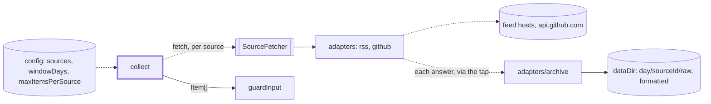
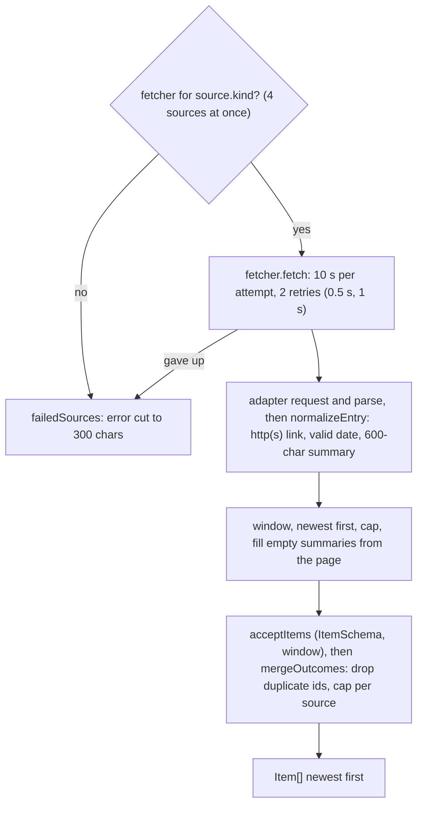

# Sources

> Fetches the allowlisted RSS/Atom feeds and GitHub releases and turns each entry into one `Item`.
> Entry: `collectStep(input, deps) → { items, failedSources }` (`collect.ts`). Port:
> `SourceFetcher`. All item text is untrusted; these URLs are the only links a digest may contain.

## Context

## Flow

- Retry: `FetchError.retryable` is final. Timeouts, 5xx, 408, 429 retry; other 4xx, a GitHub rate
  limit, a bad URL, a refused redirect and an unparseable feed do not. Else only `TimeoutError` and
  bare transport failures retry.
- The 10 s covers page enrichment too, so pages get 4 s in all (3 s each, 4 at once, 2 MiB each).
  Only entries with no text are enriched, never GitHub (`enrichable: false`). The page must be on
  the feed's host, protocol and port. A page problem is debug-logged and never fails the source.
- Entries of one feed that share a link (Google Cloud release notes) get `?entry=<id>`. The whole
  feed decides, not the window, so an entry keeps its URL from week to week.

## Rules

- A broken feed never stops the week. A source that returns nothing usable logs a warning: a quiet
  week and a silently broken feed look alike.
- `normalizeEntry` is the only place an `Item` is built: http(s) links only, made safe for the
  markup by `canonicalLink` (the link check trusts them); a zoneless date is read as UTC (`parseFeedDate`).
- Every fetch goes through `getText`: at most 5 redirects, by hand, only to the source's own host
  (`www.` is the same) or the adapter's `redirectHosts` (`api.github.com`); no https to http,
  other port, credentials in a URL or non-http(s) target. A body over 5 MiB fails the source.
- The GitHub token goes only to the start origin; the REST adapter redacts it from network errors. A
  rate limit is not retried. Release links stay on github.com. Errors name the source id and a
  refused host, never the URL: config values may carry secrets.
- Sources merge in config order, so the earlier source wins a duplicate id. Duplicates go before
  the per-source cap (`source.maxItems ?? maxItemsPerSource`), so they cannot crowd out real items.

## Files

| File                                    | Role                                                                                                       |
| --------------------------------------- | ---------------------------------------------------------------------------------------------------------- |
| `SourceFetcher.ts`, `defaultSources.ts` | The port; `DEFAULT_SOURCES` (24 feeds) and `DEFAULT_FOCUS_AREAS`                                           |
| `collect.ts`                            | `collectStep`, `MAX_CONCURRENT_SOURCES`: concurrency, timeout, retry, validation, merge, cap, order        |
| `adapters/`                             | The adapters and the shared fetch pipeline: see `adapters/CLAUDE.md`                                       |
| `adapters/entries/`                     | Entries to items: normalize, read, select, merge: see `adapters/entries/CLAUDE.md`                         |
| `adapters/archive/`                     | Saves each source's raw answers and items per day (`raw/`, `formatted/`): see `adapters/archive/CLAUDE.md` |

Tests sit next to the code; `adapters/__fixtures__/` holds feed, GitHub and article samples.

## Gotchas

- `defaultSources.test.ts` fails when `DEFAULT_SOURCES` drifts from `digest.config.example.json` or
  from the table and the "Only these hosts" paragraph in `docs/sources.md`.
- Renames break `cli/fetch/sourceRun/{buildFetchers,recorder,types}.ts` (the tap owners: `createFetcher`,
  the adapters, `SourceTap`), `app/container.ts` (the run's fetchers get the archive's tap and `wrap`)
  and `evals/recordSources.ts` (`MAX_PAGE_BYTES`, `isOnFeedHost`, `withoutElements`, `hostsOf`); evals call `collectStep`.
- Page redirects follow `hostsOf(DEFAULT_SOURCES)`: the fetcher options expose no `collectionHosts`.
- The run's abort signal (`CollectDeps.signal`) is linked into each attempt's timeout signal and ends
  a retry back-off. `collectStep` then rejects: an abort is no broken feed, so no `failedSources`.
