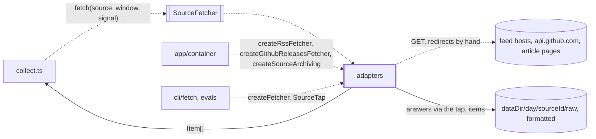
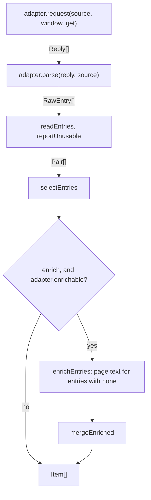

# Source adapters

> The `SourceFetcher` adapters: how a feed or an API becomes `Item[]`. An adapter only requests
> and parses (`SourceAdapter`); `createFetcher(adapter, options)` (`pipeline.ts`) wraps it into the
> port and does everything after the parse, the same for every source. Reader page:
> `docs/features/sources.md`.

## Context

## Flow

- Two readers per fetch, both `getText`: `get` for the feed or API (the source's host plus the adapter's
  `redirectHosts`; the only one the tap sees) and `getPage` for article pages (also `collectionHosts`).
- Three adapters: `rssAdapter` (RSS 2.0 and Atom), `githubAtomAdapter` (`releases.atom`),
  `createGithubRestAdapter(token)`. `createRssFetcher` and `createGithubReleasesFetcher` (REST when a
  token is set, else Atom) build the fetchers the app uses.

## Rules

- Only `getText` touches the network: redirects by hand, at most 5, only to hosts the caller
  allows; never https to http, another port, or credentials. Network allowlist.
- A feed or API body over 5 MiB fails the source, a page over 2 MiB is skipped: no hostile memory fill.
- Errors say whether another try can help: `statusFailure` (5xx, 408, 429 retry), `permanentFailure`
  (never). Adapters never retry; `collect.ts` reads `FetchError.retryable`.
- The GitHub token goes only to the start origin, and the REST adapter redacts it from network
  errors. A rate limit is not retried: asking again can lengthen the penalty.
- `parse` throws a `FetchError` only when the whole response is unusable. A bad entry is skipped,
  or (RSS) comes back with an empty url or date, so the pipeline can count it and warn once for a
  dead feed.

## Files

| File                                   | Role                                                                                  |
| -------------------------------------- | ------------------------------------------------------------------------------------- |
| `pipeline.ts`                          | `createFetcher`, `hostsOf`, `SourceAdapter`, `Get`, `SourceTap` and its event types   |
| `entries/`                             | Entries to items: normalize, read, select, merge. See `entries/CLAUDE.md`             |
| `http.ts`                              | `getText`, `sameSiteAs`, `statusFailure`, `permanentFailure`, size caps               |
| `enrich.ts`                            | `enrichEntries`: article text for entries with none; `MAX_PAGE_BYTES`, `isOnFeedHost` |
| `feedFields.ts`                        | Raw feed fields the feed library flattens; `parseFeedDate`; `XmlEntry`                |
| `rssAdapter.ts`, `rss.ts`              | The RSS and Atom adapter; `createRssFetcher`                                          |
| `githubAtomAdapter.ts`                 | The `releases.atom` adapter (about 10 releases, prereleases not flagged)              |
| `githubRestAdapter.ts`                 | The REST adapter (20 per page, no drafts or prereleases)                              |
| `githubShared.ts`, `githubReleases.ts` | `parseRepo`, `httpError`, `releaseEntry`; `createGithubReleasesFetcher`               |
| `archive/`                             | Saves each source's raw answers and items per day. See `archive/CLAUDE.md`            |

Tests sit next to the code. `__fixtures__/` holds recorded feeds, GitHub answers and article pages.

## Gotchas

- Two entry types, two names: `RawEntry` (`entries/types.ts`) is what `parse` returns; `XmlEntry`
  (`feedFields.ts`) is the feed library's own entry, read through `getExtraEntryFields`.
- `cli/fetch/fetch.tap.test.ts` scans product code: only `pipeline.ts`, `http.ts`, `rss.ts`,
  `githubReleases.ts`, `archive/archivingFetcher.ts`, `app/container.ts` and
  `cli/fetch/sourceRun/{buildFetchers,recorder,types}.ts` may use the words `tap`, `SourceTap`,
  `onAnswer`, `SourceAnswer`, `SourceEntries`, and only five files may call `createFetcher(`. So
  `entries/` avoids those words. A run passes the archive's tap (`archive/`) and `digest fetch` its own
  (`recorder.ts`).
