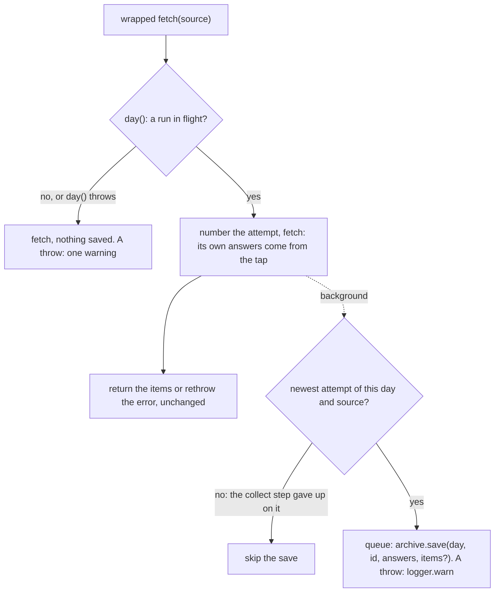

# Source archive

> Saves what each source answered (`raw/`) and the items it was read into (`formatted/`), per
> source and day, to trace a bad week to its feed. A run uses `createSourceArchiving({ archive, day,
logger })` → `{ tap, wrap, flush }`; `digest fetch` calls `createSourceArchive` directly.

## Flow

## Rules

- A failed save is a warning, never a failed source. Nothing is saved outside a run: `day` is the
  Monday of the run's ISO week, so a resume or `--force` writes the same folder.
- Saves run in the background, so the collect step's 10 s timeout covers the network, never the
  disk. `flush()` (called first in `app` `close()`) waits for all and never rejects; an exit without
  `close()` can lose the last.
- Saves of one day and source run one after the other and replace its `raw/` and `formatted/`. An
  overtaken attempt's save is skipped. The attempt counter never resets, so a number never repeats.
- Each fetch has its own `AsyncLocalStorage` context, so sources fetched at once never share answers.
- Every text written goes through `redact` (a run: all known secrets; `digest fetch`: the GitHub
  token). `responses.json` keeps a URL as origin and path only: its query may carry a secret.

## Files

| File                  | Role                                                                                      |
| --------------------- | ----------------------------------------------------------------------------------------- |
| `sourceArchive.ts`    | `createSourceArchive`: `raw/response-<n>.<ext>`, `responses.json`, `formatted/items.json` |
| `archivingFetcher.ts` | `createSourceArchiving`: the tap, `wrap`, the queues, `flush`                             |
| `*.test.ts`           | Next to the code; temp folders and fake fetchers; one test reads a real feed              |

## Gotchas

- `responses.json` lists every answer (file, url, status, contentType); one without a body gets no
  file. A non-2xx body is cut at 64 KiB. `sourceDir` refuses the id `digest`.
- `cli/fetch` builds `fetch-summary.json` from the paths `save` returns, relative to the day folder.
  `store` prune deletes these folders for old weeks and days (`store/layout.ts`).
