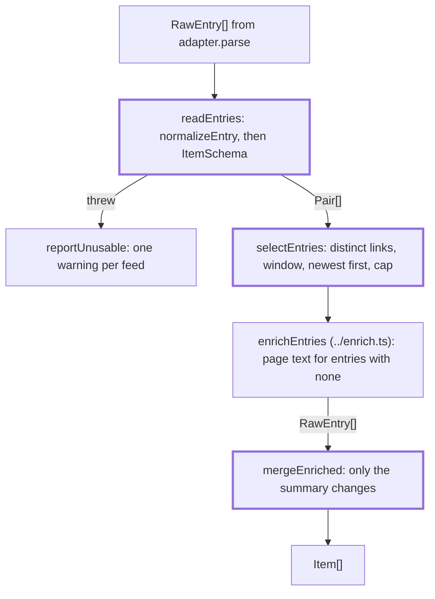

# Entries

> Turns the entries an adapter found into items and picks the ones a source keeps. `createFetcher`
> (`../pipeline.ts`) calls `readEntries`, `selectEntries` and `mergeEnriched`; `normalizeEntry`
> is the one place an `Item` is built.

## Flow

- An entry that throws costs that entry, not the feed. `reportUnusable` warns when entries threw,
  or when a feed had entries and none became an item: a changed date format would otherwise empty
  a feed without a trace. An entry with no usable link or date is left out quietly.

## Rules

- `normalizeEntry` builds every `Item`: only http(s) links and real dates get in, because the link
  check trusts what is collected. A date with a time and no zone is read as UTC.
- Shared links are judged over the whole feed, before the window, so an entry keeps its URL and id
  from week to week while the feed repeats the link.
- The cap comes after the window and before enrichment, so pages are fetched only for kept entries.

## Files

| File                | Role                                                                     |
| ------------------- | ------------------------------------------------------------------------ |
| `types.ts`          | `RawEntry` (what an adapter's `parse` returns), `Pair`                   |
| `normalizeEntry.ts` | `normalizeEntry`, `NormalizeOptions`: link, date, title, summary, id     |
| `readEntries.ts`    | `readEntries`, `reportUnusable`, `Reading`                               |
| `selectEntries.ts`  | `selectEntries`, `withDistinctLinks`: distinct links, window, order, cap |
| `mergeEnriched.ts`  | `mergeEnriched`: page text back into the items                           |

Each file has a test next to it that calls it directly. No fixtures.

## Gotchas

- `cli/fetch/fetch.tap.test.ts` scans product code: no file here may use the word `tap` or call
  `createFetcher(`.
