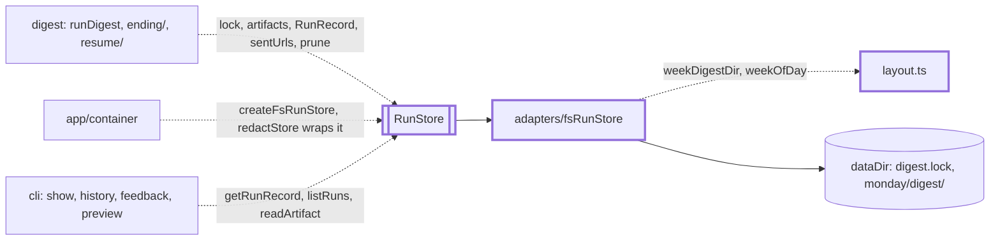

# Store

> Keeps the run history (one record and a few files per ISO week) and the lock that allows one run
> at a time. Without it a week could run twice at once, be sent twice, or repeat last week's links.
> Port: `RunStore` (`RunStore.ts`). Adapter: `createFsRunStore` (`adapters/`), plain folders.
> `layout.ts` names every folder below the data folder (`dist/` by default).

## Context



## Flow

```mermaid
sequenceDiagram
  participant run as runDigest
  participant st as fsRunStore
  participant lock as digest.lock
  run->>st: hasSentDigest(week): sent, no force: skip, no lock taken
  run->>st: acquireLock(week)
  st->>lock: create it exclusively; an abandoned lock is taken over under the .takeover guard
  st--x run: a live run holds it: DigestError "Another run is in progress"
  st->>lock: every 60 s while held: heartbeat, only if the file is still ours
  run->>st: getRunRecord again (a run that held the lock may have just sent), sentUrls
  run->>st: saveArtifact per stage, saveRunRecord, review.md, error.json, prune
  run->>st: lock.release(): stop the beat, remove the file if still ours
```

- A week lives in the folder of its Monday, `<dataDir>/<monday>/digest/` (2026-W43 is
  `dist/2026-10-19/digest/`), whatever day the run ran. The chain saves `items.json`, `scores.json`,
  `drafts.json` and `digest.md`; `endRun` saves `run.json` last. A crash leaves files and no `run.json`.

## Rules

- Run ids are ISO week ids (`WEEK_ID_PATTERN`): they become the Monday folder name (`weekDay`), so
  the methods that take one refuse any other string, also a W53 its year does not have.
- One lock per data folder, not per week: `runId` only names the holder. A live holder fails the
  caller with `DigestError` (exit 1). `release()` is safe to repeat and never removes a lock another
  run took over.
- `hasSentDigest` is true only for status `sent`. `sentUrls(week, n)` reads the `n` weeks before and
  counts a record with status `sent` or a non-empty `deliveredTo`: a part-delivered week must not repeat links.
- `prune(week, keepWeeks)` empties the weeks older than the `keepWeeks` before `week`: source folders and
  all of `digest/` except `digest.md` and the delivered `<week>.md`, `.html`, `.failed.md`. It deletes
  `run.json`, so config requires `keepWeeks >= dedupeWeeks`. `pruneOldDays` removes older days' source
  folders and `logs/<day>/`.
- A missing `run.json` reads as `undefined`; so does a corrupt, wrong-week or schema-failing one, with
  a warning. Other filesystem errors propagate. So a new `RunRecord` field must be optional.
- Secrets are removed before data gets here (`redactStore`): add no record field that could hold one.

## Files

| File           | Role                                                                                                                  |
| -------------- | --------------------------------------------------------------------------------------------------------------------- |
| `RunStore.ts`  | The port, `RunLock`, `ArtifactName`                                                                                   |
| `lockHeld.ts`  | `LOCK_HELD_MESSAGE`, `isLockHeldError`: how a caller tells a held lock from a failure                                 |
| `runRecord.ts` | `RunRecordSchema`, `RunRecord`, `DraftOutcome`: what `run.json` holds                                                 |
| `layout.ts`    | The `dist/` layout: `weekDay`, `weekOfDay`, `weekDigestDir`, `sourceDir`, `logsDir`, `dayOf`, `LOCK_FILE`. Paths only |
| `adapters/`    | The file adapter: folders, the lock, temp-folder tests. See `adapters/CLAUDE.md`                                      |

## Gotchas

- `RunStore.ts` and `test/fakes/MemoryRunStore.ts` are frozen. `fsRunStore.test.ts` ("contract parity
  with MemoryRunStore") runs the same cases on both: change port behaviour and the fake together.
- `RunRecord` embeds `DeliveryIdSchema`, `GuardCheckIdSchema` and `JudgeScoreSchema`: removing a
  value from one makes old `run.json` files unreadable.
- `scheduler/retry/attemptRun.ts` calls `isLockHeldError`; `MemoryRunStore` throws the same literal.
  Change `LOCK_HELD_MESSAGE` with both, and with `docs/operations/lock.md` and `stuck-lock.md`.
- `layout.ts` is imported by `app/container`, `config/schema`, `delivery`, `observability`,
  `sources/adapters/archive`, `cli` and `evals`: keep it free of file access. `feedback/` is not in it:
  `cli/feedback/feedback.ts` and `evals/feedbackToLabels.ts` each spell the folder name out. A source
  with the id `digest` would share its day folder with `digest/`, so `config/schema` refuses it.
