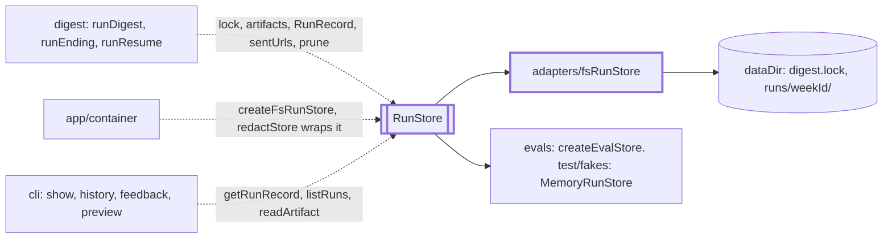
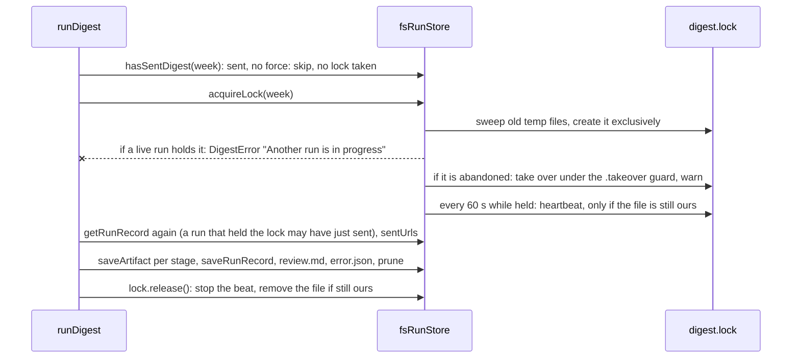

# Store

> Keeps the run history (one record and a few files per ISO week) and the lock that allows one run
> at a time. Without it a week could run twice at once, be sent twice, or repeat last week's links.
> Port: `RunStore` (`RunStore.ts`). Adapter: `createFsRunStore` (`adapters/`), plain folders.

## Context

## Flow

- The chain saves `items.json`, `scores.json`, `drafts.json` and `digest.md` per stage. `endRun`
  saves `run.json`, then `review.md` and `error.json`, then prunes (best effort). A crash leaves
  files and no `run.json`.

## Rules

- Run ids are ISO week ids (`WEEK_ID_PATTERN`): they become folder names, so the methods that take
  one refuse any other string (`saveRunRecord` fails its schema first).
- One lock per data folder, not per week: `runId` only names the holder. A live holder fails the
  caller with `DigestError` "Another run is in progress" (exit 1). `release()` is safe to repeat and
  never removes a lock another run took over.
- `hasSentDigest` is true only for status `sent`. `sentUrls(week, n)` reads the `n` weeks before
  `week` and counts a record with status `sent` or a non-empty `deliveredTo`: a partly delivered
  week must not repeat its links.
- `prune(week, keepWeeks)` empties the folders older than `week` outside the `keepWeeks` before it,
  but keeps `digest.md`. It deletes `run.json`, so a pruned week leaves `sentUrls`: config requires
  `keepWeeks >= dedupeWeeks` (`config/schema.ts:165`).
- A missing `run.json` reads as `undefined`; so does a corrupt or wrong-week one, with a warning.
  Other filesystem errors propagate. A `run.json` that fails the schema reads as missing, so its
  week looks unsent: a new `RunRecord` field must be optional.
- Secrets are removed before data gets here (`redactStore`, `app/redacting.ts`): add no record
  field that could hold one.

## Files

| File           | Role                                                                    |
| -------------- | ----------------------------------------------------------------------- |
| `RunStore.ts`  | The port, `RunLock`, `ArtifactName`                                     |
| `runRecord.ts` | `RunRecordSchema`, `RunRecord`, `DraftOutcome`: what `run.json` holds   |
| `adapters/`    | The file adapter: folders, atomic files, the lock. `adapters/CLAUDE.md` |
| `*.test.ts`    | Next to the code; temp folders and fake clocks; no fixtures             |

## Gotchas

- `RunStore.ts` and `test/fakes/MemoryRunStore.ts` are frozen files. `fsRunStore.test.ts`
  ("contract parity with MemoryRunStore") runs the same cases on both: change port behaviour and
  the fake together.
- `RunRecord` embeds `DeliveryIdSchema` (delivery), `GuardCheckIdSchema` (guards) and
  `JudgeScoreSchema` (select). Removing a value from one makes old `run.json` files unreadable.
- The scheduler does not call `isLockHeldError`: `scheduler.ts:149` keeps its own copy of the
  text, and `MemoryRunStore` throws the same literal. Change `LOCK_HELD_MESSAGE` with both.
- `delivery/adapters/markdownFile` and `cli/preview` import `writeFileAtomic`: keep its signature.
- Update `docs/operations/lock.md` and `docs/runbooks/debug/stuck-lock.md` with any lock rule.
