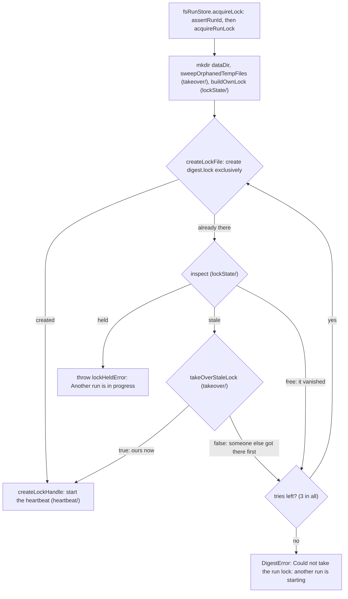

# Store adapters

> The file `RunStore`: `createFsRunStore({ dataDir, clock?, logger? })` (`fsRunStore.ts`). One
> `digest/` folder per ISO week (in its Monday's folder, `../layout.ts`), one lock file per data
> folder, atomic writes, no database. `runLock.ts`
> only orders the lock steps; the work sits in `lockState/`, `heartbeat/` and `takeover/`.

## Flow

On disk: `<dataDir>/digest.lock` (the lock, JSON), `digest.lock.takeover` (the guard, for
milliseconds) and `<monday>/digest/` with `run.json` and the six artifacts.

## Rules

- Every write is `writeFileAtomic` (`shared/atomicFile.ts`): a temp file `<name>.<pid>.<uuid>.tmp` in the same folder,
  fsync, rename. A reader sees the old file or the new one, never half. No plain `writeFile`.
- `createFileExclusive` hard-links a temp file, so a new file appears complete or not at all.
  FAT, exFAT and some network or FUSE mounts have no hard links: a raw `EPERM` or `ENOTSUP`.
- `ARTIFACT_FILES` is the one table of artifact names. `satisfies Record<ArtifactName, string>`
  fails typecheck when it and the port type disagree; `artifactFile` uses `Object.hasOwn`, so
  `constructor` or `__proto__` throw `DigestError` before any path is built.
- Plain files give no OS lock. The known limits (a holder stalled past the heartbeat timeout can
  lose its lock and run on; a hung process keeps it) are in the doc comment of `acquireRunLock`.
  The heartbeat only logs the loss; `digest/` guards delivery and the record against it (`deliver`, `endRun`).
- `hasSentDigest` and `sentUrls` go through `readDeliveryFacts`: the full record when `run.json` parses,
  else its `status`, `deliveredTo` and `sentUrls` alone (no enums), with the same warning.

## Files

| File                                  | Role                                                                                                                                                                                                                                                                                   |
| ------------------------------------- | -------------------------------------------------------------------------------------------------------------------------------------------------------------------------------------------------------------------------------------------------------------------------------------- |
| `fsRunStore.ts`                       | `createFsRunStore`: all port methods on the folder layout                                                                                                                                                                                                                              |
| `artifactFiles.ts`                    | `ARTIFACT_FILES`, `artifactFile(name)`                                                                                                                                                                                                                                                 |
| `runFolders.ts`                       | `assertRunId`, `runDir`, `listWeekFolders` (Monday folders with `digest/`, newest first), `readRunRecord`, `readDeliveryFacts`, `pruneWeekFolder` (a week's source folders, and its `digest/` but `digest.md` and `<week>.*`), `pruneOldDays` (older source folders and `logs/<day>/`) |
| `runLock.ts`                          | `acquireRunLock`, `AcquireLockOptions` (host, PID namespace, beat interval for tests)                                                                                                                                                                                                  |
| `lockState/` `heartbeat/` `takeover/` | The lock, by job. Each has its own `CLAUDE.md`                                                                                                                                                                                                                                         |
| `lockContender.ts`                    | Child process of the contention test; not app code                                                                                                                                                                                                                                     |
| `*.test.ts`                           | Next to the code. `fsRunStore.test.ts` covers `runFolders.ts` (`fsRunStore.unreadable.test.ts`: a `run.json` the schema refuses); no fixtures                                                                                                                                          |

## Gotchas

- `runLock.contention.test.ts` is the only test of the real race (4 processes, 40 rounds, slow).
  Run it after any change to the lock, the guard or the heartbeat.
- `heartbeat/` and `takeover/` import only `shared/atomicFile` and `lockState`: not each other, not `runLock.ts`.
- A new artifact goes in `ArtifactName` (`../RunStore.ts`, frozen) and in `ARTIFACT_FILES`.
