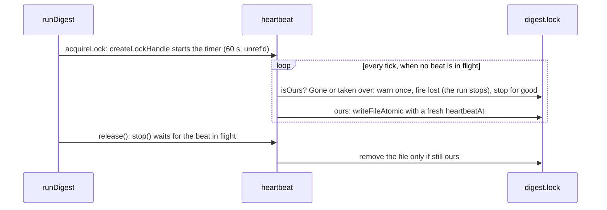

# Heartbeat

> Keeps our lock alive while a run works, fires `lost` when it is gone, removes it at the end. A
> lock from another container cannot be checked by pid, so the holder rewrites `heartbeatAt` on a
> timer; a silent one is presumed dead after 5 min. Entry: `createLockHandle(lockPath, mine, options)`.

## Flow

## Rules

- A beat never throws: a failed write is logged and the next tick tries again. A slow disk skips
  beats; ticks never queue, so at most one beat is in flight.
- `release()` is safe to repeat and leaves a lock another run took over. The handle counts as
  released only after the removal worked, so a failed removal can be retried.
- `lost` fires once (`lockLostReason()`); a failed beat, `stop()` and `release()` never fire it.
- The beat follows the event loop, not the run's progress: a hung run in a live process keeps its
  lock. That limit is in the doc comment of `acquireRunLock`.

## Files

| File            | Role                                                            |
| --------------- | --------------------------------------------------------------- |
| `heartbeat.ts`  | `startHeartbeat`, `Heartbeat` (with `lost`), `HeartbeatOptions` |
| `lockHandle.ts` | `createLockHandle`: the `RunLock` returned by `acquireRunLock`  |
| `*.test.ts`     | One per file, with a 15 ms beat (`FAST_BEAT_MS`) and real files |

## Gotchas

- `stop()` must await the beat in flight, or a late beat can bring a released lock file back.
- Keep the check-then-write order: a beat that skips `isOurs` could overwrite a takeover.
- The warning `Run lock is no longer ours ...; this run stops` is quoted in `docs/operations/lock.md`.
