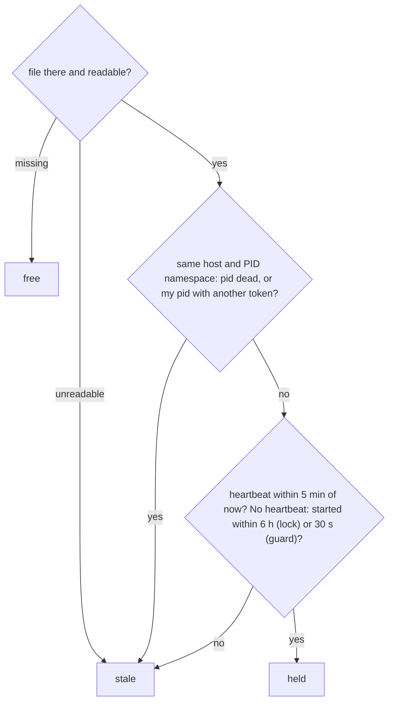

# Lock state

> Answers one question about a lock file: free, held or stale, and is it ours? Entry:
> `inspect(path, now, me, kind)` (`liveness.ts`); `kind` is `lock` or `guard` (the takeover guard).

## Flow

## Rules

- A pid only means something where it was written. A missing host or PID namespace (older locks;
  macOS and Windows have none) counts as a match. `EPERM` from the pid probe counts as alive.
- A heartbeat is judged both ways: 5 min in the future (a clock that was ahead) is as stale as
  5 min old. A guard ignores its heartbeat.
- Timings (`lockTimings.ts`): beat 60 s, abandoned 5 min, a lock with no heartbeat 6 h, guard 30 s,
  orphaned temp files 10 min. Interval × 3 stays under the timeout (`lockTimings.test.ts`).
- `parseLockFile` gives `undefined` for anything unreadable, so `inspect` says stale. `isLockHeldError`
  matches a `DigestError` starting with `LOCK_HELD_MESSAGE` ("Another run is in progress").

## Files

| File               | Role                                                                                   |
| ------------------ | -------------------------------------------------------------------------------------- |
| `lockTimings.ts`   | The five `*_MS` constants                                                              |
| `lockFile.ts`      | Schema, `LockFile`, `OwnLock`, `parseLockFile`, `sameLock`, `createLockFile`, `isOurs` |
| `liveness.ts`      | `staleReason`, `inspect`, `LockState`, `LockKind`                                      |
| `ownLock.ts`       | `buildOwnLock`, `readPidNamespace`, the per-process token                              |
| `lockHeldError.ts` | `LOCK_HELD_MESSAGE`, `lockHeldError`, `isLockHeldError`                                |
| `*.test.ts`        | One per file; `liveness.test.ts` pins each limit on both sides                         |

## Gotchas

- `LOCK_HELD_MESSAGE` is copied in `scheduler.ts:149` and `MemoryRunStore` and quoted in
  `docs/runbooks/debug/stuck-lock.md`. Nothing outside the store calls `isLockHeldError`.
- A new lock file field must be optional, or older locks turn unreadable and get taken over.
