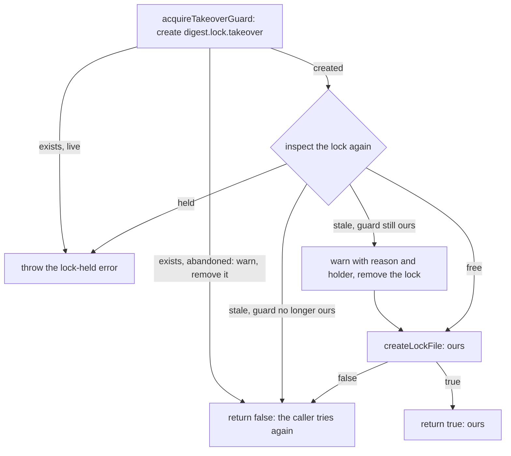

# Takeover

> Clears what a crashed run left. `takeOverStaleLock(mine, options)` replaces a stale lock with ours
> under a guard file; `sweepOrphanedTempFiles(options)` removes temp files a killed run left.

## Flow

## Rules

- Plain files give no OS lock: two contenders could both see a stale lock, and the second would
  delete the first one's fresh lock. The guard lets one through; `finally` removes it if still ours.
- The guard is abandoned after 30 s or when its process is dead. Before each destructive step it is
  re-checked with `isOurs`, because another run may have broken it as abandoned.
- `false` is not an error. `acquireRunLock` tries 3 times in all, then throws a plain `DigestError`
  that `isLockHeldError` does not match.
- The sweep runs in `acquireRunLock` before the first try, lock or not. It removes
  `digest.lock.<pid>.<uuid>.tmp` and the same for the guard once 10 min old, and never throws (a
  failure is logged). It keeps younger files (a live writer) and anything not named exactly so.

## Files

| File               | Role                                                  |
| ------------------ | ----------------------------------------------------- |
| `takeoverGuard.ts` | `GUARD_SUFFIX`, `guardPathOf`, `acquireTakeoverGuard` |
| `takeover.ts`      | `takeOverStaleLock`, `TakeoverOptions`                |
| `orphanSweep.ts`   | `sweepOrphanedTempFiles`, `OrphanSweepOptions`        |
| `*.test.ts`        | One per file                                          |

## Gotchas

- Keep every guard re-check: `takeover.test.ts` swaps the guard at the exact clock reading where
  the check happens. After any change run `../runLock.contention.test.ts`, the only real-race test.
