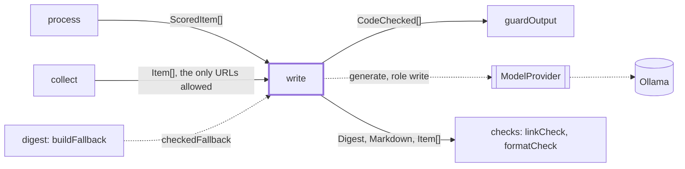
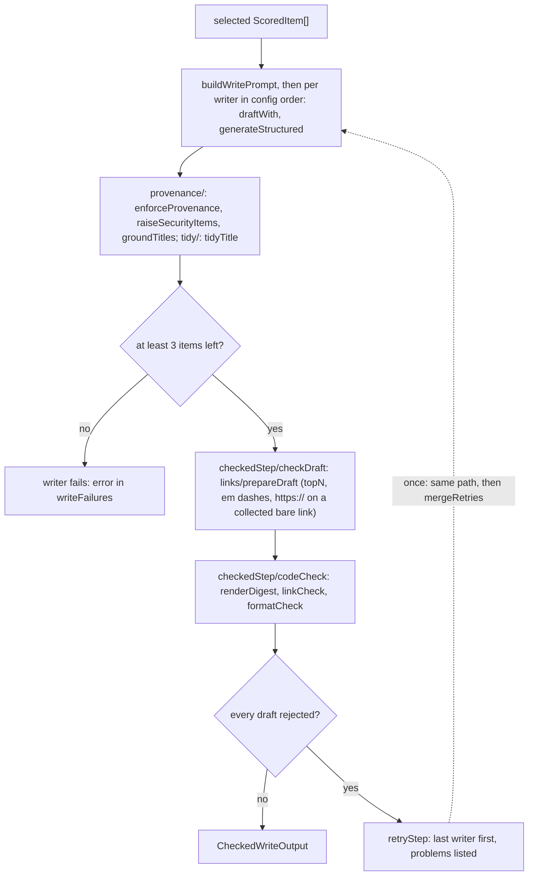

# Write

> A panel of writer models each drafts the weekly digest from the selected items. The step limits
> what a writer can get wrong, fixes small faults in code, runs the checks, retries once.
> Entry: `writeCheckedStep(items, deps) → CheckedWriteOutput` (`write.ts`). Uses `ModelProvider`.

## Context

## Flow

- Retry: only when every draft was rejected, once per writer that has a draft, last writer first
  (its model is still loaded). It replaces the first draft; a failed retry keeps it (`retryFailures`).
- `problems` list format problems first. `rejections` (`drafts.json`) and the log keep them
  bounded (`boundProblems`), links unmasked. The retry prompt (a `check-problems` block) masks
  every link as `[url removed]`, shows a fault once, keeps `MAX_PROBLEMS` (5), each cut to
  `PROBLEM_MAX_CHARS` (200).
- No draft passes the checks and guards: `digest/fallback.ts` calls `checkedFallback`, a
  model-free digest of each item's title, url and first summary sentences (up to
  `DIGEST_SUMMARY_WORD_LIMIT` words), links removed.

## Rules

- URL provenance: the model names an item (`itemId`) and never picks its link; `url` comes from
  the collected item. `WrittenItemSchema` makes `url` optional, so a bad one never costs a repair.
- The security floor and the title repair (`provenance/`) and the bare-link repair (`links/`) are
  exact and bounded; see their `CLAUDE.md`. A title with a version, id or date its source lacks gets
  the source title; a summary or `action` is not repaired, and an `action` is not link-repaired.
- Prompt limits come from `checks/formatCheck.ts`, so prompt and check cannot drift; the writer is
  asked for less (400 words, summary 30, action 15).
- `WriteDeps.perspective` adds `This week's perspective: <topic>; favour what speaks to it.` after the
  focus areas in the first and the retry prompt (`cleanPerspective` from classify); absent means the
  prompts are unchanged. `write.perspective.test.ts` pins it.
- Writers run in turn (one model in memory); `draftWith` turns a model error into a failure, so a
  failed writer never stops the next. Under 3 items no writer runs (`tooFewItems`).
- `WriteDeps.signal` (the run's abort signal) goes to every writer call. `writeStep` and `retryStep`
  call `signal?.throwIfAborted()` before each writer, and `draftWith` rethrows the signal's reason
  when it fired: an aborted call is never `writeFailures` or `retryFailures`, no later writer
  starts, no retry follows, and `drafts.json` is not written (the stage fails as
  `Run aborted during the write step`).

## Files

| File                | Role                                                                                             |
| ------------------- | ------------------------------------------------------------------------------------------------ |
| `write.ts`          | `writeStep`, `retryStep`, `writeCheckedStep`, `draftWith`, `WriteDeps`, `CheckedWriteDeps`       |
| `writerSchema.ts`   | `WrittenItemSchema`, `DigestBodySchema`: what the model must write                               |
| `writePrompt.ts`    | `buildWritePrompt`, `buildRetryPrompt`, `boundProblems`, prompt targets, problem limits          |
| `fallbackDigest.ts` | `buildFallbackDigest`, `checkedFallback`, `cutSummary`: the digest made without a model          |
| `links/`            | `prepareDraft`, bare-link repair; see `links/CLAUDE.md`                                          |
| `tidy/`             | Em dashes, restated release tags, `safeSourceText`; see `tidy/CLAUDE.md`                         |
| `provenance/`       | Source urls, no repeats, the security floor, title facts; see `provenance/CLAUDE.md`             |
| `checkedStep/`      | `codeCheck`, `checkDraft`, rejections, `mergeRetries`, result types; see `checkedStep/CLAUDE.md` |

Tests sit next to the code and script `FakeModelProvider` replies per writer tag. No fixtures.

## Gotchas

- `LINK_PROBLEM_KINDS` in `writePrompt.ts` is keyed by `UNKNOWN_URL_PROBLEM` and `MALFORMED_LINK_PROBLEM`
  from `checks/linkCheck.ts`; `writePrompt.retry.test.ts` runs the real check.
- `digest/stages/write.ts` reads `writeCheckedStep` and its `rejections`; `digest/chain/state.ts` and
  `digest/fallback.ts` read `CheckedDraft`, `CodeChecked` (`checkedStep/types.ts`), `checkedFallback`
  and `FALLBACK_WRITER`.
- Subfolders never import `write.ts`: `checkedStep/` sits above `links/`, `links/` above `tidy/`.
