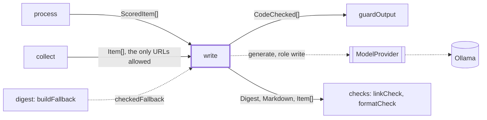
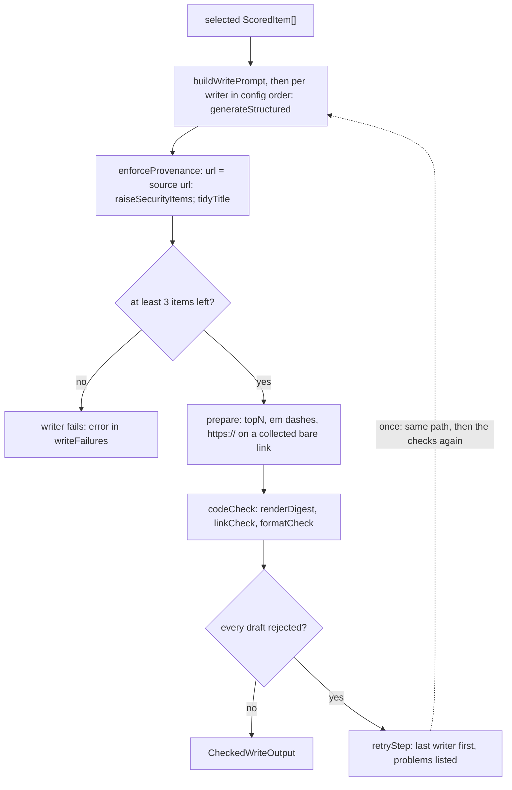

# Write

> A panel of writer models each drafts the weekly digest from the selected items. The step limits
> what a writer can get wrong, fixes small faults in code, runs the checks, retries once.
> Entry: `writeCheckedStep(items, deps) → CheckedWriteOutput` (`write.ts`). Uses `ModelProvider`.

## Context

## Flow

- Retry: only when every draft was rejected, once per writer that has a draft, last writer first
  (its model is still loaded). It replaces the first draft; a failed retry keeps it (`retryFailures`).
- `problems` list format problems first, then link problems. `rejections` (`drafts.json`, attempt 1
  or 2) and the log keep them bounded (`boundProblems`), links unmasked. Problems quote model text,
  so the retry prompt (a `check-problems` data block) masks every link as `[url removed]`, shows a
  fault once, and keeps at most `MAX_PROBLEMS` (5), each cut to `PROBLEM_MAX_CHARS` (200).
- No draft passes the checks and guards: `digest/fallback.ts` calls `checkedFallback`, a
  model-free digest of each item's title, url and first summary sentences (up to
  `DIGEST_SUMMARY_WORD_LIMIT` words), links removed.

## Rules

- URL provenance: the model names an item (`itemId`) and never picks its link; `url` comes from
  the collected item. `WrittenItemSchema` makes `url` optional, so a bad one never costs a repair.
- Security floor: a good-to-know item whose collected source (title and summary, never the model's
  text) names a CVE, a `GHSA-` id, a vulnerability, or a security advisory, fix, patch, update or
  release becomes worth-a-look, with a fixed action if it has none. It never goes higher.
- Bare-link repair is exact and bounded: only `www.` and `//host` links, only when `https://` plus
  the token is exactly a collected url. Tokens over `MAX_LINK_CHARS` (2048) are skipped; up to
  `MAX_TRAILING_CHARS` (8) closing characters are tried off the end. An `action` is not repaired.
- `urgency` and `action` are required in `WrittenItemSchema`; `DigestSchema` keeps them optional
  for older drafts. `prepare` cuts an action to 200 characters; the word limits are the check's.
- Prompt limits (3-5 items, 500 words, 3 act-now) come from `checks/formatCheck.ts`, so prompt and
  check cannot drift. The writer is asked for less: 400 words, summary 30, action 15.
- Writers run in turn (one model in memory, `OLLAMA_MAX_LOADED_MODELS=1`); `draftWith` never
  rejects, so a failed writer never stops the next. Under 3 items no writer runs (`tooFewItems`).

## Files

| File                | Role                                                                                                |
| ------------------- | --------------------------------------------------------------------------------------------------- |
| `write.ts`          | `writeStep`, `retryStep`, `writeCheckedStep`, `codeCheck`, `prepareDraft`; provenance, floor, links |
| `writePrompt.ts`    | `buildWritePrompt`, `buildRetryPrompt`, `boundProblems`, prompt targets, problem limits             |
| `fallbackDigest.ts` | `buildFallbackDigest`, `checkedFallback`, `cutSummary`: the digest made without a model             |

Tests sit next to the code and script `FakeModelProvider` replies per writer tag. No fixtures.

## Gotchas

- `LINK_PROBLEM_KINDS` in `writePrompt.ts` matches the `linkCheck` problem prefixes. Change both;
  `writePrompt.retry.test.ts` runs the real check. A reworded problem is still masked, unexplained.
- `runDigest.ts` reads `CodeChecked`, `CheckedDraft` and `rejections`; `digest/fallback.ts` reads
  `checkedFallback` and `FALLBACK_WRITER`. Renames break both.
- `write.ts` is 506 lines, over the 300 cap: move link repair and the floor to subfolders first.
