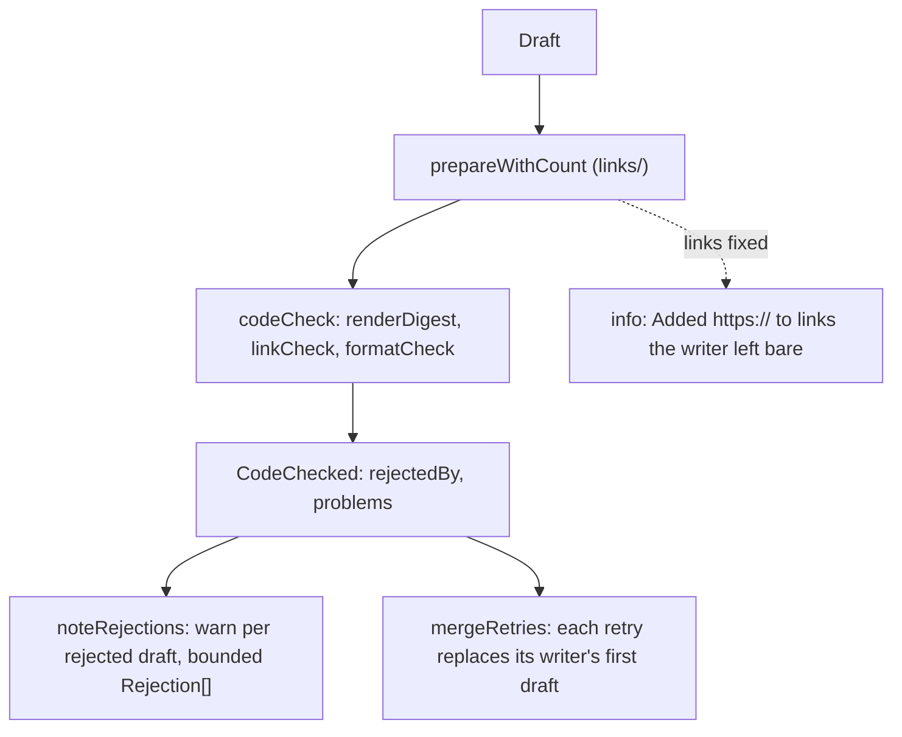

# Checked step

> The checking half of `writeCheckedStep`: what happens to a draft after the writer returns it.
> Entries: `checkDraft(draft, context) → CodeChecked`, `noteRejections`, `mergeRetries`.
> `write.ts` calls the writers and decides when to retry.

## Flow

- `rejectedBy` is `linkCheck` and/or `formatCheck`; `problems` lists format problems first.
  `noteRejections` takes attempt 1 for a first draft, 2 for a retry.

## Rules

- The checks run on the Markdown the reader gets, after the fixes, so a draft that only lacked
  `https://` passes without a retry.
- `problems` stay whole on a `CodeChecked`; each consumer bounds them with `boundProblems` (retry
  prompt, log, `drafts.json`). Format problems first, so many bad links cannot hide a word count.
- A retry is taken only for a writer that had a first draft, and one whose retry gave nothing keeps
  its first. Writers are unique (the config schema says so), so matching by writer is safe.
- No model call here, and nothing imports `write.ts`.

## Files

| File                | Role                                                          |
| ------------------- | ------------------------------------------------------------- |
| `types.ts`          | `CheckedDraft`, `CodeChecked`, `Rejection`, `CheckContext`    |
| `codeCheck.ts`      | `codeCheck`: render, link check, format check                 |
| `checkDraft.ts`     | `checkDraft`: prepare, log the repaired links, `codeCheck`    |
| `noteRejections.ts` | `noteRejections`: log and return the rejected drafts, bounded |
| `mergeRetries.ts`   | `mergeRetries`, `MergedRetries`                               |

One test file per code file; `../write.checked.test.ts` runs the retry flow.

## Gotchas

- `digest/runDigest.ts` and the run record read the ids `linkCheck` and `formatCheck`. Keep them.
- The warn `Draft failed the checks` and its fields are asserted in tests and read in the run log.
