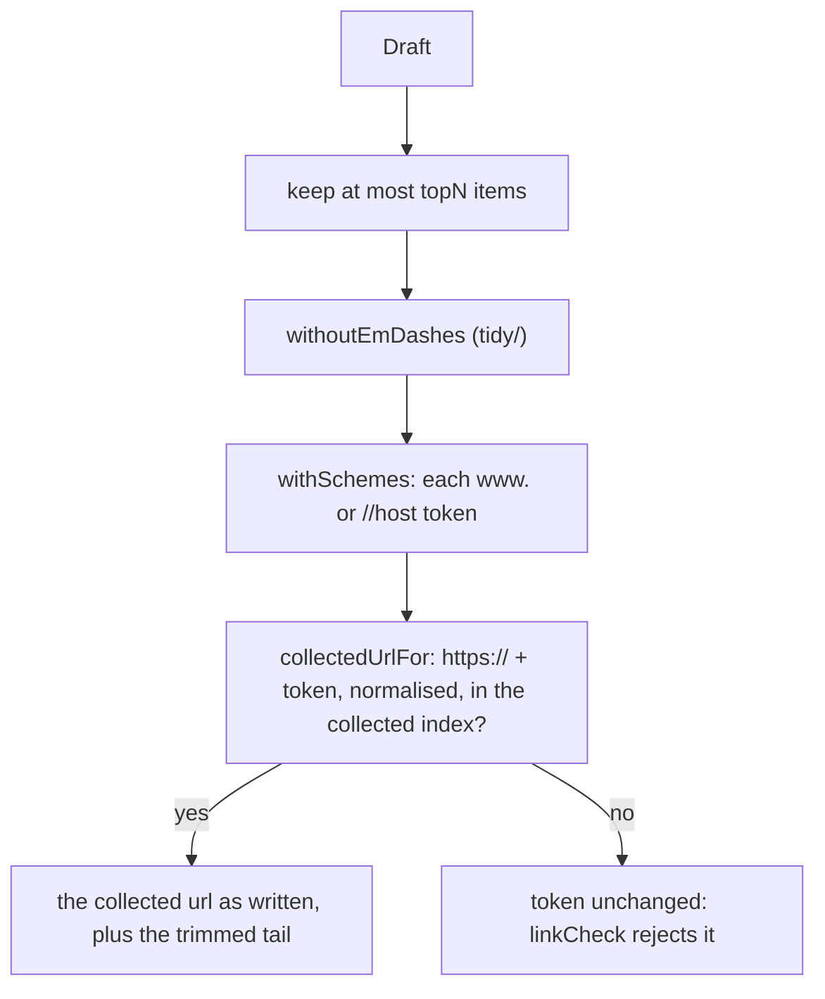

# Links

> Makes every link in a draft a collected url, and applies the other small fixes a draft needs
> before the checks. Entries: `prepareWithCount(draft, topN, collectedUrls)` (what the step calls)
> and `prepareDraft(...) → Draft` (the same, draft only) in `prepareDraft.ts`.

## Flow

- `prepareWithCount` is `prepareDraft` plus the number of links fixed, for the log line.
- Fields: headline, intro, each item's title, area, summary and why-it-matters. An action gets em
  dashes removed and is cut to 200 characters, with no link repair.

## Rules

- The draft only gains urls the link check accepts: an invented link stays so the check rejects it.
- Work per token is bounded: over `MAX_LINK_CHARS` (2048) it is skipped without a lookup; at most
  `MAX_TRAILING_CHARS` (8) closing characters are tried off the end.
- Only `https://` is added, so a url collected as `http://` is not repaired.
- A match starts at the start of the text or after a space or an opening or emphasis character, so a
  `//` or `www.` inside the path or query of another url never starts one.

## Files

| File                   | Role                                                                                           |
| ---------------------- | ---------------------------------------------------------------------------------------------- |
| `withSchemes.ts`       | `withSchemes`, `collectedUrlFor`, `indexCollectedUrls`, `MAX_LINK_CHARS`, `MAX_TRAILING_CHARS` |
| `prepareDraft.ts`      | `prepareDraft`, `prepareWithCount`, `PreparedDraft`                                            |
| `withSchemes.test.ts`  | Resolving, trailing characters, caps, links left for the check to reject                       |
| `prepareDraft.test.ts` | Every field, text that must stay alone, bounds (mocks `normalizeUrl`), action, topN            |

## Gotchas

- A looser match is a security change: add a case showing the bypass is still closed.
- Known quirk: a full stop right after a collected url ending in `/` is read as a `.` path
  segment, so the url matches and the full stop is lost. `withSchemes.test.ts` pins it.
