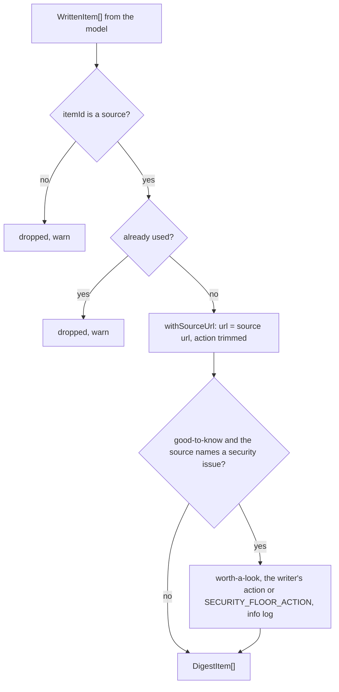

# Provenance

> What the code forces on a draft whatever the model wrote: the source url, no repeated or invented
> items, and the security floor. Entries: `enforceProvenance(drafted, sources, logger)`,
> `raiseSecurityItems(items, sources, logger)`.

## Flow

- `namesSecurityIssue` reads the source title and summary for a CVE, a `GHSA-` id, a security
  advisory, fix, patch, update or release, or a vulnerability.

## Rules

- The url always comes from the collected item. A model url, even a plausible one, is replaced.
- The floor only raises. An act-now or worth-a-look item, or one with no urgency, comes back as is.
- The floor reads the source, never the written text: a CVE the model adds raises nothing. It errs
  toward worth-a-look: "vulnerability" in a scanner feature raises too.
- A raised item always has an action, so the floor cannot fail the format check's "needs an action".

## Files

| File                        | Role                                                                |
| --------------------------- | ------------------------------------------------------------------- |
| `enforceProvenance.ts`      | `enforceProvenance`, `withSourceUrl` (an empty action is left out)  |
| `securityFloor.ts`          | `raiseSecurityItems`, `namesSecurityIssue`, `SECURITY_FLOOR_ACTION` |
| `loggedId.ts`               | `loggedId`: an item id cut to 80 characters for logs (model output) |
| `enforceProvenance.test.ts` | Replaced urls, dropped and repeated items, order, logs              |
| `securityFloor.test.ts`     | Which sources count, no demotion, source not writer, logs           |
| `loggedId.test.ts`          | Short ids stay, long ids are cut                                    |

## Gotchas

- Changing the floor words is a security change: add a case for the new word and one that must
  stay untouched. `write.urgency.test.ts` runs the same rules through `writeStep`.
